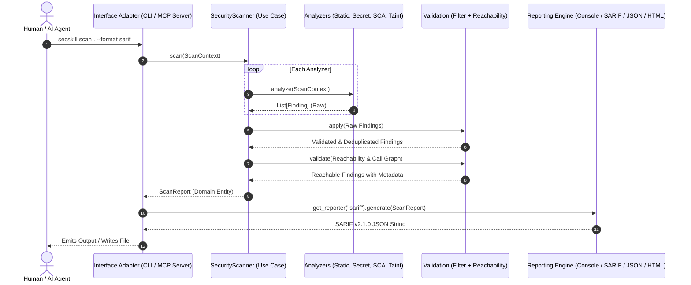

# SecSkill Clean Architecture Specification

> **Audience:** Human Software Engineers and Autonomous AI Agents (Claude Code, Cursor, Google Antigravity, OpenAI Codex).
> **Goal:** Maintain modularity, testability, separation of concerns, and zero regressions across the codebase.

---

## 1. High-Level Architecture Overview

SecSkill is designed according to **Clean Architecture** (Robert C. Martin / Uncle Bob) principles and Domain-Driven Design (DDD). Source code dependencies point strictly inward toward higher-level business policies:

```mermaid
graph TD
    subgraph Layer4["Layer 4: Frameworks & Drivers (Infrastructure)"]
        FS["Filesystem / OS Utilities (secskill.utils.files)"]
        GIT["Git Engine (secskill.utils.git)"]
        NOTIF["OS Notifications & Sound (secskill.notifier)"]
        CFG["Config & Settings Loader (secskill.config)"]
        HTTP["HTTP Client & OSV (httpx)"]
    end

    subgraph Layer3["Layer 3: Interface Adapters"]
        CLI["Typer CLI (secskill.cli)"]
        MCP["MCP Server Protocol (secskill.mcp_server)"]
        FACADE["Agent Skill Facade (secskill.agent_skill)"]
        REP["Reporters: Console, SARIF, JSON, MD, HTML (secskill.reporting)"]
        GRAPH["Attack Path Visualizer (secskill.visual_graph)"]
    end

    subgraph Layer2["Layer 2: Application / Use Cases"]
        SCANNER["SAST Security Scanner (secskill.scanner)"]
        WEBSCAN["DAST Website Scanner (secskill.analyzers.web_scan)"]
        AUDITOR["Agent & MCP Auditor (secskill.agent_audit)"]
        VERIFY["Remediation Verifier (secskill.services.remediation)"]
        KNOW["Security Explainer (secskill.services.knowledge)"]
        ARENA["Red vs. Blue Duel Arena (secskill.duel)"]
        WATCH["Secret Watcher (secskill.watcher)"]
        INSTALL["Agent Installer & Sync (secskill.installer, updater)"]
    end

    subgraph Layer1["Layer 1: Domain Entities (Core)"]
        FINDING["Finding & Severity (secskill.models)"]
        CONTEXT["ScanContext (secskill.models)"]
        REPORT["ScanReport & WebScanReport (secskill.models)"]
        RULE["Security Rule Definitions (secskill.models)"]
    end

    Layer4 --> Layer3
    Layer3 --> Layer2
    Layer2 --> Layer1
```



---

## 2. The 4 Clean Architectural Layers

### Layer 1: Entities (Core Domain)
- **Path:** `secskill/models.py`
- **Responsibilities:**
  - Encapsulates enterprise business entities, value objects, and enumerations.
  - Core structures: `Finding`, `Severity`, `Confidence`, `TriageStatus`, `ScanContext`, `Rule`, `ScanReport`, `WebScanReport`.
- **Invariants:**
  - Zero external dependencies on UI frameworks, CLI tools, databases, or MCP protocols.
  - Pure Pydantic data schemas representing the immutable domain language.

### Layer 2: Application / Use Cases (Business Logic)
- **Paths:**
  - `secskill/scanner.py`: SAST Pipeline Orchestrator. Coordinates Static, Secret, Dependency, and Dataflow analyzers.
  - `secskill/services/knowledge.py`: MITRE CWE, OWASP Top 10, NIST, ISO 27001 vulnerability taxonomy and attack vector simulations.
  - `secskill/services/remediation.py`: Automated before-and-after patch verification and regression analysis.
  - `secskill/analyzers/`: Concrete security analysis strategies (`StaticAnalyzer`, `SecretAnalyzer`, `DependencyAnalyzer`, `DataflowAnalyzer`, `WebSecurityScanner`).
  - `secskill/validation/`: Finding post-processing (`FindingFilter`, `ReachabilityValidator`, `MitigationChecker`).
  - `secskill/agent_audit/`: Auditing engine for AI agent configurations, prompt files, tool manifests, and MCP servers.
  - `secskill/duel/`: Autonomous Red Team vs. Blue Team hardening battle engine.
  - `secskill/watcher.py`: Secret leak file watcher and entropy evaluator.
  - `secskill/installer.py` & `secskill/updater.py`: Omni-agent skill installer and synchronizer.
  - `secskill/templates.py`: Centralized configuration templates for agents (Claude, Cursor, Antigravity, Codex) and CI/CD.
- **Invariants:**
  - Application logic depends only on Layer 1 (Entities).
  - Business services never import or depend on Layer 3 (Interface Adapters).

### Layer 3: Interface Adapters (Presenters & Controllers)
- **Paths:**
  - `secskill/cli.py`: Typer CLI entrypoint. Parses user flags and delegates to Layer 2 use cases.
  - `secskill/mcp_server.py`: Model Context Protocol stdio server. Bridges LLM agents (Claude Code, Cursor, Antigravity) to SecSkill services via JSON-RPC 2.0.
  - `secskill/agent_skill.py`: Python API facade providing a simplified, synchronous interface for programmatic agent integration.
  - `secskill/reporting/`: Pluggable output formatters (`ConsoleReporter`, `SarifReporter`, `JsonReporter`, `MarkdownReporter`, `HtmlReporter`) managed via `get_reporter(format)`.
  - `secskill/visual_graph.py`: Dataflow visualizer emitting Mermaid diagrams, Unicode terminal pipelines, and interactive HTML maps.
- **Invariants:**
  - **No Sibling Coupling:** Adapters do NOT call other adapters (e.g., `cli.py` does not instantiate `SecSkillMCPServer`; both call `explain_security_topic` in Layer 2).
  - Adapters transform data from the format convenient for use cases into the format convenient for external consumers (terminal, stdout JSON-RPC, SARIF file, HTML).

### Layer 4: Frameworks & Drivers (Infrastructure)
- **Paths:**
  - `secskill/config.py`: Configuration and YAML environment settings.
  - `secskill/notifier.py`: Cross-platform desktop toast notifications (PowerShell WinRT XML on Windows, afplay on macOS, bell on Linux).
  - `secskill/utils/files.py`: Safe directory traversal, `.gitignore` / `.secskillignore` pattern matching.
  - `secskill/utils/git.py`: Subprocess execution for git commit, branch, and diff retrieval.
  - `secskill/utils/logging.py`: Structured application logging.

---

## 3. End-to-End Dataflow Diagram

The lifecycle of a scan execution from CLI or MCP to final report:



---

## 4. Directory & Module Responsibilities Map

| Path | Architectural Role | Responsibility |
| :--- | :--- | :--- |
| `secskill/models.py` | **Domain Entities** | Canonical Pydantic schemas: `Finding`, `Severity`, `ScanReport`, `WebScanReport`. |
| `secskill/scanner.py` | **Use Case** | SAST scan orchestrator (Analyzers -> Filter -> Reachability -> Triage). |
| `secskill/templates.py` | **Domain Templates** | Centralized agent instruction files (`SKILL.md`, `.cursorrules`, GitHub Workflows). |
| `secskill/services/` | **Application Services** | Shared use cases (`knowledge.py` for CWE taxonomy, `remediation.py` for patch verification). |
| `secskill/analyzers/` | **Domain Analyzers** | AST static scanning, secrets regex, dependency lockfiles, taint analysis, live DAST. |
| `secskill/validation/` | **Domain Validation** | Line ignore comments (`# secskill:ignore`), false-positive filters, entrypoint reachability. |
| `secskill/reporting/` | **Interface Presenters** | Factory `get_reporter()` producing Console, SARIF 2.1.0, JSON, Markdown, and HTML reports. |
| `secskill/agent_audit/` | **Agent Security Subsystem** | Audits prompt architecture, MCP configs, tool privileges, and agent skills. |
| `secskill/duel/` | **Duel Arena Subsystem** | Autonomous adversarial Red Team vs. Blue Team code hardening battle. |
| `secskill/mcp_server.py` | **Interface Adapter** | Standard JSON-RPC 2.0 stdio MCP server for Claude Code, Cursor, and Antigravity. |
| `secskill/cli.py` | **Interface Adapter** | Thin Typer CLI controller delegating all commands to use cases. |
| `secskill/agent_skill.py` | **Interface Adapter** | Synchronous Python API facade for autonomous agents. |
| `secskill/watcher.py` | **Use Case** | Real-time filesystem polling and Shannon entropy secret leak detector. |
| `secskill/notifier.py` | **Infrastructure Driver** | Native OS desktop notification dispatching (WinRT, macOS, Linux). |
| `secskill/utils/` | **Infrastructure** | File discovery, ignore evaluation, git subprocess execution, logging. |

---

## 5. Extension Guides for AI Agents & Humans

### How to Add a New SAST Security Rule
1. Open the relevant rule catalog in `secskill/rules/` (e.g., `python.yaml`, `javascript.yaml`, or `owasp_top10.yaml`).
2. Add the rule block:
   ```yaml
   - id: "SEC-PY-099"
     name: "Insecure Temporary File Creation"
     severity: "HIGH"
     cwe: "CWE-377"
     owasp: "A01:2021-Broken Access Control"
     patterns:
       - 'tempfile\.mktemp\('
     languages: ["python"]
     description: "Use of mktemp() is deprecated and susceptible to symlink race conditions."
     remediation: "Use tempfile.NamedTemporaryFile() or tempfile.TemporaryDirectory() with strict permissions."
   ```
3. Run `pytest tests/test_analyzers.py` to verify rule discovery and matching.

### How to Add a New MCP Tool
1. In `secskill/mcp_server.py`:
   - Add tool metadata and input schema to the `TOOLS` list.
   - Add a dispatch handler in `_execute_tool(name, args)` delegating to a Layer 2 application service.
2. Run `pytest tests/test_mcp_server.py`.

### How to Add a New Report Format
1. Create a reporter in `secskill/reporting/` inheriting from `BaseReporter`:
   ```python
   from secskill.reporting.base import BaseReporter
   from secskill.models import ScanReport

   class CsvReporter(BaseReporter):
       def generate(self, report: ScanReport, output_path=None) -> str:
           # Format CSV rows
           ...
   ```
2. Register the new reporter in `secskill/reporting/__init__.py`:
   ```python
   REPORTER_REGISTRY["csv"] = CsvReporter
   ```
3. Expose the format option in `secskill/cli.py` under `@app.command() def scan(...)`.

---

## 6. Coding Standards & Architectural Invariants

1. **The Dependency Rule:** Dependencies must only point inward. Infrastructure -> Adapters -> Use Cases -> Entities.
2. **Never Call Sibling Adapters:** CLI commands and MCP tools must never invoke each other; always call the underlying service in `secskill.services` or `secskill.scanner`.
3. **Secret Redaction Invariant:** Detected credentials, API tokens, and private keys must ALWAYS be redacted (first 4 and last 3 characters visible: `AKIA...XYZ`). Never log or print raw secrets.
4. **Zero Regression Policy:** Every change must preserve 100% test passing rate across the pytest suite (`pytest`).

