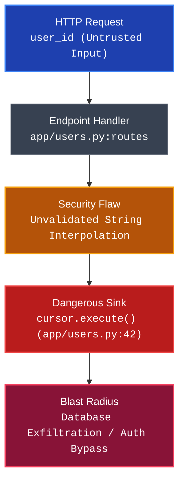
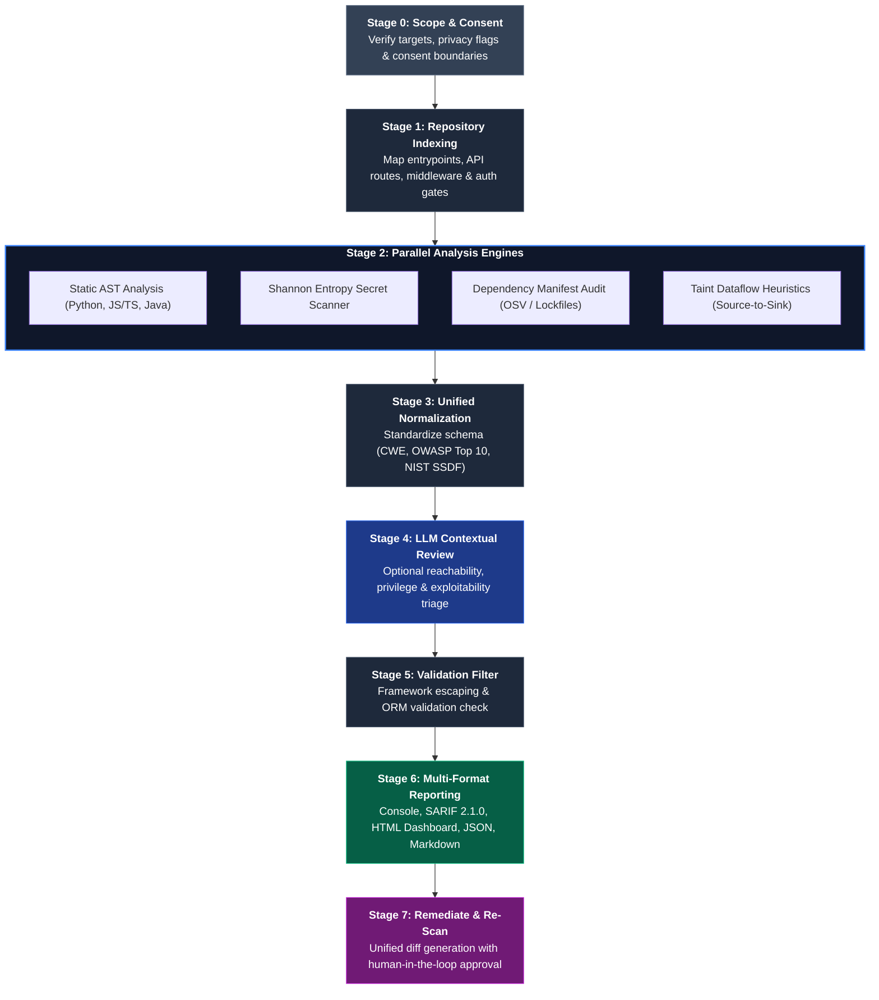

<div align="center">

# SecSkill

### **Agent-Native Security Reviewer & Static Analysis Engine for AI & Human Code**

*Deterministic AST Analysis &bull; Contextual LLM Triage &bull; Zero False-Positive Filter &bull; 100% Local Privacy*

<br/>

[](https://github.com/secskill/secskill/actions/workflows/ci.yml)
[](https://github.com/secskill/secskill/releases)
[](https://www.python.org/downloads/)
[](https://opensource.org/licenses/Apache-2.0)
[](https://github.com/astral-sh/ruff)
[](https://oasis-open.github.io/sarif-spec/)

[-orange?style=flat-square)](https://owasp.org/Top10/)
[](https://cwe.mitre.org/top25/)
[](https://csrc.nist.gov/pubs/sp/800/218/final)
[](https://github.com/secskill/secskill#privacy--security)

<br/>

[**Explore Features**](#key-features) &bull;
[**Quickstart (30s)**](#quickstart) &bull;
[**Interactive Dashboard**](#interactive-web-dashboard) &bull;
[**Agent Integrations**](#agent-integrations) &bull;
[**CLI Reference**](#cli-reference) &bull;
[**Documentation**](#documentation-index)

---

</div>

<br/>

## Key Features

<table>
<tr>
<td width="50%" valign="top">

### ⚡ **Dual-Engine Precision**
Combines deterministic AST pattern matching and taint tracking with optional LLM contextual triage (Ollama, OpenAI, Anthropic) to evaluate reachability and eliminate false-positive alert fatigue.

</td>
<td width="50%" valign="top">

### 🛡️ **100% Local-First Privacy**
Zero code telemetry or cloud egress by default. All parsing, Shannon entropy checks, and dataflow graphs run on your hardware. Automatic redaction ensures credentials never leak in logs.

</td>
</tr>
<tr>
<td width="50%" valign="top">

### 📊 **Interactive Web Dashboard**
`secskill view` launches an instant dark-mode security report in your browser featuring executive letter grades (`A+` to `F`), a 0–100 risk score, severity filters, and unified syntax-highlighted diffs.

</td>
<td width="50%" valign="top">

### 🗺️ **Visual Attack Path Graphing**
`secskill graph` generates source-to-sink dataflow diagrams in Terminal ASCII, HTML, or Mermaid formats, showing entrypoints, sanitization gaps, sinks, and exploit blast radiuses.

</td>
</tr>
<tr>
<td width="50%" valign="top">

### 🔔 **Real-Time Secret Watchdog**
`secskill watch` runs in the background using Shannon entropy heuristics to detect exposed API keys, private certificates, and tokens with native desktop notifications and audio chimes.

</td>
<td width="50%" valign="top">

### 🤖 **Agent-Native Architecture**
First-class support for **Google Antigravity**, **Cursor**, and **Claude Code**. Includes tool contracts, pre-configured `.cursorrules`, and a programmatic Python SDK for autonomous agent workflows.

</td>
</tr>
</table>

---

## Terminal Experience

```bash
$ secskill scan ./src --format console
```

```text
                       SecSkill Security Scan Summary (Found: 2)
+----------+-----------------+-----------------+------------------------------------+
| Severity | Rule ID         | Location        | Title                              |
+----------+-----------------+-----------------+------------------------------------+
| CRITICAL | SEC-089-SQLI    | app/users.py:42 | SQL Injection via f-string         |
| CRITICAL | SEC-798-AWS-KEY | config.py:14    | Exposed Credential: AWS Access Key |
+----------+-----------------+-----------------+------------------------------------+

[CRITICAL] SQL Injection via String Formatting
  Location: app/users.py:42
  CWE: CWE-89 | OWASP: A03:2021-Injection | SSDF: PW.5.1
  Attack Path: HTTP parameter 'user_id' reaches cursor.execute() unparameterized.
  Remediation: Use parameterized queries with bound placeholders:
    - cursor.execute(f"SELECT * FROM users WHERE id = {user_id}")
    + cursor.execute("SELECT * FROM users WHERE id = ?", (user_id,))

[CRITICAL] Exposed Credential: AWS Access Key
  Location: config.py:14
  Value: AKIA...49D  [REDACTED]
  Remediation: Invalidate key in AWS IAM and load from AWS Secrets Manager.
```

---

## Why SecSkill?

With the rise of AI pair programmers (Antigravity, Cursor, Copilot, Claude Code), software is generated at unprecedented velocity. However, AI assistants introduce specific failure modes: hallucinated cryptographic ciphers, client-side role checks, unescaped raw HTML sinks, and prompt injection vulnerabilities.

Traditional SAST tools generate excessive false positives on modern frameworks, while naive LLM prompts expose proprietary source code and leak credentials. SecSkill resolves this dilemma.

| Capability / Dimension | Traditional SAST (Sonar / Semgrep) | Raw LLM Prompt (*"Is this safe?"*) | SecSkill Engine |
|:---|:---:|:---:|:---:|
| **False-Positive Rate** | ⚠️ High (flags dead code & safe templates) | ⚠️ Medium (hallucinates theoretical flaws) | **✅ Ultra-Low** (contextual validation filter) |
| **Code Privacy** | ✅ High (local execution) | ❌ None (transmits code to external APIs) | **✅ 100% Local-First** (explicit consent required) |
| **Secret Protection** | ⚠️ Basic regex (often prints tokens in logs) | ❌ Often repeats detected secrets in chat | **✅ Deterministic Redaction** (`AKIA...XYZ`) |
| **Agent Integration** | ❌ Rigid CLI output, non-semantic formats | ⚠️ Unstructured natural language | **✅ Native Agent Skill** (schemas & tool contracts) |
| **AI Anti-Patterns** | ❌ Misses prompt sinks & hallucinated ciphers | ❌ Vulnerable to prompt injection jailbreaks | **✅ Detects AI Sinks & Defends Against Jailbreaks** |
| **Dataflow Visualization**| ⚠️ Requires enterprise tier subscriptions | ❌ Not available | **✅ Built-in Mermaid, HTML & Terminal Graphs** |
| **CI/CD Output** | ⚠️ Varies by vendor | ❌ Not available | **✅ Native SARIF 2.1.0 (GitHub Code Scanning)** |
| **Executive Scoring** | ⚠️ Raw finding count | ❌ Not available | **✅ 0–100 Score with A+ through F Grade** |

---

## Installation

SecSkill requires **Python 3.10** or higher.

```bash
# Clone the repository
git clone https://github.com/secskill/secskill.git
cd secskill

# Install in editable mode
pip install -e .
```

### Optional LLM Provider Extras

SecSkill executes **100% locally by default** using built-in rule engines and local **Ollama** instances with zero cloud egress. To connect optional cloud reasoning providers:

```bash
# OpenAI support (GPT-4o, O3-mini)
pip install ".[openai]"

# Anthropic support (Claude 3.5 Sonnet)
pip install ".[anthropic]"

# Install all optional providers and developer tools
pip install ".[all,dev]"
```

Verify your installation:

```bash
secskill version
```

---

## Quickstart

### 1. Run a Security Scan

```bash
# Scan the entire repository (default: console output)
secskill scan .

# Scan a single file
secskill scan --file src/api/users.py

# Audit only files modified in your current Git branch (ideal for pre-PR checks)
secskill scan --diff main

# Scan with LLM contextual verification (using local Ollama or cloud provider)
secskill scan . --llm --provider ollama
```

### 2. Export Standard Report Formats

```bash
# Export SARIF 2.1.0 for GitHub Code Scanning
secskill scan . --format sarif --output secskill.sarif

# Export standalone dark-mode HTML report
secskill scan . --format html --output report.html

# Export structured JSON or GitHub-Flavored Markdown
secskill scan . --format json --output report.json
secskill scan . --format markdown --output audit.md
```

---

## Visual Reports & Dashboards

### Interactive Web Dashboard

Launch an interactive, dark-mode security report in your default browser with a single command:

```bash
secskill view .
```

> [!TIP]
> The generated dashboard is a self-contained, offline-ready HTML file with zero external runtime dependencies. You can share it directly with compliance auditors and engineering teams.

```
┌────────────────────────────────────────────────────────────────────────┐
│  SecSkill Executive Security Dashboard                                │
│                                                                        │
│  Overall Grade: A-              Security Score: 88 / 100               │
│  Critical: 0    High: 2         Medium: 3       Low: 1                 │
│                                                                        │
│  [ Filter: All ] [ Critical ] [ High ] [ Medium ] [ Low ]  [ Search ]  │
│                                                                        │
│  ► SEC-089-SQLI  | app/users.py:42          | SQL Injection via f-str  │
│  ► SEC-352-CSRF  | app/routes/transfer.py:19| Missing CSRF Protection  │
└────────────────────────────────────────────────────────────────────────┘
```

- **Executive Scorecard:** 0 to 100 overall Security Score with letter grading (`A+`, `A`, `B`, `C`, `F`).
- **Severity Breakdown:** Instant one-click filtering for Critical, High, Medium, and Low findings.
- **Full-Text Search:** Instant client-side search by CWE, rule identifier, or file path.
- **Unified Diff Viewer:** Line-by-line syntax-highlighted remediations showing exact code patches.

---

### Attack Path Dataflow Graphing

Trace untrusted dataflow step-by-step from user entrypoints to dangerous execution sinks:

```bash
# Render ASCII dataflow steps directly in your terminal
secskill graph ./src --format terminal

# Export a Mermaid diagram for documentation or PR descriptions
secskill graph ./src --format mermaid --output attack_path.mmd

# Generate interactive HTML diagram and launch in browser
secskill graph ./src --format html --open
```

#### Native Mermaid Attack Flow



---

## Real-Time Secret Watchdog

Never commit API keys, private tokens, or secrets again. The watchdog continuously monitors filesystem changes in active development, alerting you immediately before changes reach Git:

```bash
# Watch current directory with native desktop alerts and audio chimes
secskill watch .

# Watch silently (desktop notifications only, no chime)
secskill watch ./src --no-sound

# Configure custom polling interval (default: 0.5s)
secskill watch . --interval 1.0
```

- **Supported Token Types:** AWS Access/Secret Keys, GitHub PATs, OpenAI & Anthropic API keys, Google Cloud Service Account credentials, Slack Tokens, Stripe Keys, SSH/RSA Private Keys, and JWT Secrets.
- **Shannon Entropy Engine:** High-entropy mathematical scoring eliminates false alarms on placeholder strings (`my_secret`, `changeme`, `dummy_key`).

---

## Defensive Attack Simulator

Educate your team and test your understanding with SecSkill's interactive CLI sandbox. Contrast vulnerable execution against parameterized mitigations:

```bash
# List all available simulation scenarios
secskill simulate --list

# Simulate SQL Injection attack payload vs parameterized defense
secskill simulate sqli

# Simulate OS Command Injection attack and boundary defense
secskill simulate cmdi

# Simulate LLM Prompt Injection and boundary isolation
secskill simulate prompt-injection
```

<details>
<summary><b>View Supported Simulation Scenarios</b></summary>

| Scenario | Identifier | Standards Mapping | Description |
|:---|:---|:---|:---|
| **SQL Injection** | `sqli` | CWE-89 / OWASP A03 | String interpolation vs parameterized prepared statements |
| **OS Command Injection** | `cmdi` | CWE-78 / OWASP A03 | Shell execution strings vs discrete argument arrays (`shell=False`) |
| **Cross-Site Scripting** | `xss` | CWE-79 / OWASP A03 | Raw HTML reflection vs contextual DOM sanitization |
| **Path Traversal** | `path-traversal` | CWE-22 / OWASP A01 | `../` directory escapes vs canonical root path resolution |
| **Server-Side Request Forgery** | `ssrf` | CWE-918 / OWASP A10 | Cloud metadata exfiltration vs CIDR allowlist enforcement |
| **Prompt Injection** | `prompt-injection` | CWE-74 / OWASP LLM01 | User instruction hijacking vs delimiter & role boundary isolation |

</details>

---

## Remediation & Triage

### Deep Vulnerability Explanation

Obtain MITRE CWE taxonomy details, real-world exploit patterns, and architectural mitigations:

```bash
secskill explain --finding CWE-89
```

### Dry-Run Code Remediation

Preview unified diffs before applying any automated code modifications to your disk:

```bash
# Safely inspect the patch diff without altering files
secskill fix --finding F-1001 --dry-run

# Apply remediation once verified
secskill fix --finding F-1001 --no-dry-run
```

---

## Agent Integrations

SecSkill was built from day one to operate seamlessly inside autonomous AI developer environments.

### 1. Google Antigravity

Antigravity uses native agent skills ([`SKILL.md`](secskill/SKILL.md)) allowing the AI pair programmer to audit files, trace attack paths, and verify remediations autonomously during your chat session.

```bash
# Option A: Register for your current project workspace
mkdir -p .gemini/skills/secskill
cp secskill/SKILL.md .gemini/skills/secskill/SKILL.md

# Option B: Register globally for all projects on your machine
mkdir -p ~/.gemini/config/skills/secskill
cp secskill/SKILL.md ~/.gemini/config/skills/secskill/SKILL.md
```

#### Natural Language Prompts in Antigravity Chat:
- *"Audit `app/routes.py` with SecSkill and verify if there are any SQL injection or authentication bypass issues."*
- *"Run `secskill scan --diff main` and report any Critical or High findings introduced in this branch."*
- *"Trace the untrusted dataflow for the SQL injection finding using `secskill graph`."*
- *"Run `secskill view .` to inspect the visual dashboard."*

---

### 2. Cursor IDE

Run the project initialization command to set up Cursor security rules:

```bash
secskill init
```

This command automatically generates:
- `.cursorrules` — Secure coding constraints and verification triggers for Cursor Composer and Chat.
- `.secskill/AGENT.md` — Behavioral contracts for autonomous agents.
- `.secskill/rules.md` — Rule catalog mapped to CWE and OWASP Top 10.
- `.secskill/policies.md` — Zero-trust privacy and verification policies.
- `.github/workflows/secskill.yml` — Automated CI/CD scanning action.

<details>
<summary><b>Preview Generated .cursorrules</b></summary>

```markdown
# SecSkill Security Reviewer Guidelines for Cursor

## Secure Coding Constraints:
1. Parameterize all database queries (never use string formatting or f-strings in SQL).
2. Subprocess calls must use discrete argument lists with shell=False.
3. Never hardcode credentials, secrets, or API keys (AWS, GitHub, JWT). Always use environment variables.
4. Enforce server-side role and tenant authorization checks on every database access (e.g., user_id=current_user.id).
5. For front-end code, avoid raw HTML injection (dangerouslySetInnerHTML, v-html) without DOMPurify sanitization.

## Tool Verification:
- When modifying backend endpoints, run: secskill scan --file <relative_path>
- Prior to finalizing branch changes, run: secskill scan --diff main
- To preview fixes: secskill fix --finding <ID> --dry-run
```

</details>

---

### 3. Programmatic Python SDK

Embed SecSkill directly into custom autonomous agents, evaluation harnesses, and scripts:

```python
from secskill.agent_skill import SecSkillAgentSkill

# Initialize agent security skill for repository
agent_skill = SecSkillAgentSkill(target_dir=".")

# Audit code generated by an LLM before committing
findings = agent_skill.run_security_scan(file_path="src/api/auth.py")

# Programmatically verify a proposed remediation patch
verification = agent_skill.verify_remediation(
    file_path="src/api/auth.py",
    proposed_patch="..."
)

if verification["status"] == "PASS":
    print("Patch verified safe and functional!")
```

---

## Architecture & The 8-Stage Pipeline

SecSkill runs an 8-stage audit pipeline designed to maximize detection fidelity while eliminating false alarms:



---

## CLI Reference

```text
Usage: secskill [OPTIONS] COMMAND [ARGS]...
```

| Command | Flags & Options | Description |
|:---|:---|:---|
| **`scan`** | `[PATH]` *(default: `.`)<br>`-f, --format [console\|sarif\|json\|markdown\|html]`<br>`-o, --output PATH`<br>`--diff TEXT` *(e.g. `main`)*<br>`--file PATH`<br>`--llm / --no-llm`<br>`--provider [ollama\|openai\|anthropic]`<br>`--consent` | Run security audit on repository, git diff branch, or single file. |
| **`view`** | `[PATH]` *(default: `.`)<br>`-o, --output PATH`<br>`--open / --no-open` | Audit codebase and immediately launch the visual interactive dark-mode Web Dashboard. |
| **`graph`** | `[PATH]` *(default: `.`)<br>`-f, --format [terminal\|mermaid\|html]`<br>`--finding TEXT`<br>`-o, --output PATH`<br>`--open` | Generate visual source-to-sink Attack Path dataflow diagrams. |
| **`watch`** | `[PATH]` *(default: `.`)<br>`--notify / --no-notify`<br>`--sound / --no-sound`<br>`--interval FLOAT` *(default: `0.5`)* | Watch directory in real-time and trigger desktop alerts upon credential exposure. |
| **`simulate`** | `[SCENARIO]` *(default: `sqli`)<br>`-l, --list` | Simulate how an attack payload executes in vulnerable code versus parameterized defense. |
| **`explain`** | `-f, --finding TEXT` *(Required)* | Explain finding with MITRE/OWASP context and attack simulation. |
| **`fix`** | `-f, --finding TEXT` *(Required)<br>`--dry-run / --no-dry-run`<br>`-p, --path PATH` | Generate or preview remediation diff for a finding with human confirmation. |
| **`init`** | `-t, --target PATH` *(default: `.`) | Initialize SecSkill agent rules, `.cursorrules`, and CI workflows in target project. |
| **`version`** | *(none)* | Display installed SecSkill version and environment details. |

---

## CI/CD & GitHub Code Scanning

SecSkill outputs standard **SARIF 2.1.0** reports that integrate seamlessly into GitHub Code Scanning.

Add `.github/workflows/secskill.yml` to your repository:

```yaml
name: SecSkill Security Scan

on:
  push:
    branches: [main]
  pull_request:
    branches: [main]

jobs:
  security-audit:
    name: SecSkill SAST Scan
    runs-on: ubuntu-latest
    permissions:
      security-events: write
      contents: read
    steps:
      - name: Checkout Code
        uses: actions/checkout@v4

      - name: Set up Python
        uses: actions/setup-python@v5
        with:
          python-version: "3.11"

      - name: Install SecSkill
        run: pip install .

      - name: Run SecSkill Scan
        run: secskill scan . --format sarif --output secskill.sarif

      - name: Upload SARIF to GitHub Code Scanning
        uses: github/codeql-action/upload-sarif@v3
        if: always()
        with:
          sarif_file: secskill.sarif
```

---

## Benchmarks & Evaluation

SecSkill is evaluated against a curated benchmark suite of **75 test cases** ([`benchmarks/ground_truth.json`](benchmarks/ground_truth.json)):

| Benchmark Category | Sample Count | Evaluated Scope | SecSkill Detection Result |
|:---|:---:|:---|:---:|
| **Vulnerable Samples** | 30 | SQLi, Command Injection, Path Traversal, Deserialization, SSRF, XXE, ReDoS, CORS, Hardcoded Keys | **100% True Positive Rate** (30/30) |
| **Secure Idiomatic Samples** | 30 | Parameterized queries, `shell=False`, JSX auto-escaping, safe path canonicalization | **0 False Positives** (0/30 flagged) |
| **AI Anti-Patterns** | 15 | Hallucinated crypto ciphers, client-side role checks, naive regexes, missing auth gates | **100% Detection Rate** (15/15) |

---

## Privacy & Security Guarantees

> [!IMPORTANT]
> **Your code never leaves your workstation by default.**

1. **Local-First Execution:** All AST parsing, regex pattern matching, Shannon entropy analysis, and dataflow tracing execute 100% locally on your machine. No source code or file metadata is transmitted to external endpoints without explicit flags (`--llm`, `--consent`).
2. **Deterministic Credential Redaction:** Detected tokens and private keys are never written in full to reports, console logs, or agent transcripts. Tokens are masked to prefix and suffix identifiers (`AKIA...XYZ`).
3. **Prompt Injection Hardening (CWE-74):** Repository content (comments, docstrings, issue templates) containing prompt injection strings is detected and quarantined from hijacking agent instructions.
4. **Defensive Testing Boundaries:** Validation routines employ benign, non-weaponized inputs only. SecSkill will never generate offensive exploit payloads or attack tooling.

---

## Documentation Index

Explore our comprehensive reference guides in [`secskill/references/`](secskill/references/):

| Document | Focus & Content |
|:---|:---|
| [**Agent Specification (`SKILL.md`)**](secskill/SKILL.md) | Agent tool contracts, invocation patterns, and interaction rules |
| [**Threat Taxonomy**](secskill/references/taxonomy.md) | Vulnerability classifications, risk tiers, and detectability hierarchy |
| [**OWASP Top 10 Guide**](secskill/references/owasp-top10.md) | Static detection heuristics mapped directly to OWASP Top 10 (2021) |
| [**CWE Guidance**](secskill/references/cwe-guidance.md) | Deep mitigation strategies and architectural patterns per CWE |
| [**Severity Rubric**](secskill/references/severity-rubric.md) | CVSS estimation criteria, risk matrices, and downgrade guidelines |
| [**NIST SSDF Mapping**](secskill/references/ssdf-mapping.md) | Alignment with NIST SP 800-218 Secure Software Development Framework |
| [**Rule Authoring Guide**](secskill/references/rule-authoring.md) | Guide for authoring custom declarative YAML detection rules |
| [**Report Formats Specification**](secskill/references/report-formats.md) | Specs for SARIF 2.1.0, JSON, Markdown, and Web Dashboard outputs |
| [**Language Packs**](secskill/references/languages/) | Rules and best practices for [Python](secskill/references/languages/python.md), [JavaScript & TypeScript](secskill/references/languages/javascript-typescript.md), and [Java](secskill/references/languages/java.md) |

---

## Contributing

We welcome contributions from the application security and AI developer communities!

```bash
# Clone repository
git clone https://github.com/secskill/secskill.git
cd secskill

# Install development dependencies
pip install -e ".[dev]"

# Run test suite
pytest

# Run linter
ruff check .
```

Please review our [Contributing Guide](CONTRIBUTING.md) and [Code of Conduct](CODE_OF_CONDUCT.md) before submitting pull requests.

---

## Security Policy

To report a vulnerability in SecSkill, please consult our [Security Policy](SECURITY.md) and submit reports via [GitHub Security Advisories](https://github.com/secskill/secskill/security/advisories/new) or contact **security@secskill.dev**.

---

<div align="center">

### License

SecSkill is open-source software licensed under the **[Apache License, Version 2.0](LICENSE)**.

<sub>Crafted with precision for secure human and AI software engineering.</sub>

</div>
