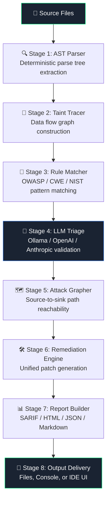

<div align="center">

<svg xmlns="http://www.w3.org/2000/svg" width="860" height="220" viewBox="0 0 860 220">
  <defs>
    <linearGradient id="bgGrad" x1="0%" y1="0%" x2="100%" y2="100%">
      <stop offset="0%" style="stop-color:#0d1117;stop-opacity:1" />
      <stop offset="100%" style="stop-color:#1a2332;stop-opacity:1" />
    </linearGradient>
    <linearGradient id="shieldGrad" x1="0%" y1="0%" x2="0%" y2="100%">
      <stop offset="0%" style="stop-color:#00ff88;stop-opacity:1" />
      <stop offset="100%" style="stop-color:#00aa55;stop-opacity:1" />
    </linearGradient>
    <filter id="glow">
      <feGaussianBlur stdDeviation="3.5" result="coloredBlur"/>
      <feMerge>
        <feMergeNode in="coloredBlur"/>
        <feMergeNode in="SourceGraphic"/>
      </feMerge>
    </filter>
    <filter id="textGlow">
      <feGaussianBlur stdDeviation="6" result="coloredBlur"/>
      <feMerge>
        <feMergeNode in="coloredBlur"/>
        <feMergeNode in="SourceGraphic"/>
      </feMerge>
    </filter>
  </defs>

  <!-- Background -->
  <rect width="860" height="220" rx="16" fill="url(#bgGrad)"/>

  <!-- Subtle grid lines -->
  <line x1="0" y1="55" x2="860" y2="55" stroke="#ffffff08" stroke-width="1"/>
  <line x1="0" y1="110" x2="860" y2="110" stroke="#ffffff08" stroke-width="1"/>
  <line x1="0" y1="165" x2="860" y2="165" stroke="#ffffff08" stroke-width="1"/>
  <line x1="215" y1="0" x2="215" y2="220" stroke="#ffffff05" stroke-width="1"/>
  <line x1="430" y1="0" x2="430" y2="220" stroke="#ffffff05" stroke-width="1"/>
  <line x1="645" y1="0" x2="645" y2="220" stroke="#ffffff05" stroke-width="1"/>

  <!-- Glow orb behind shield -->
  <ellipse cx="108" cy="110" rx="68" ry="68" fill="#00ff88" opacity="0.07"/>

  <!-- Shield shape -->
  <path d="M108,42 L148,60 L148,105 Q148,145 108,165 Q68,145 68,105 L68,60 Z"
        fill="url(#shieldGrad)" filter="url(#glow)" opacity="0.95"/>
  <!-- Shield inner highlight -->
  <path d="M108,52 L140,67 L140,105 Q140,138 108,155 Q76,138 76,105 L76,67 Z"
        fill="none" stroke="#ffffff30" stroke-width="1.5"/>

  <!-- Checkmark inside shield -->
  <polyline points="92,108 103,120 126,94"
            fill="none" stroke="#0d1117" stroke-width="4.5"
            stroke-linecap="round" stroke-linejoin="round"/>

  <!-- "SecSkill" text -->
  <text x="195" y="105"
        font-family="'Courier New', Courier, monospace"
        font-size="62" font-weight="800"
        fill="#ffffff" filter="url(#textGlow)" opacity="0.98">
    Sec<tspan fill="#00ff88" filter="url(#glow)">Skill</tspan>
  </text>

  <!-- Tagline -->
  <text x="197" y="142"
        font-family="'Courier New', Courier, monospace"
        font-size="15.5" fill="#8b9ab0" letter-spacing="0.5">
    Agent-Native Security Reviewer &amp; Static Analysis Engine
  </text>

  <!-- Version pill -->
  <rect x="197" y="158" width="130" height="24" rx="12" fill="#00ff8822" stroke="#00ff8855" stroke-width="1"/>
  <text x="262" y="174" text-anchor="middle"
        font-family="'Courier New', Courier, monospace"
        font-size="12" fill="#00ff88" font-weight="600">v0.1.0-beta</text>

  <!-- Apache pill -->
  <rect x="337" y="158" width="110" height="24" rx="12" fill="#3b82f622" stroke="#3b82f655" stroke-width="1"/>
  <text x="392" y="174" text-anchor="middle"
        font-family="'Courier New', Courier, monospace"
        font-size="12" fill="#60a5fa" font-weight="600">Apache 2.0</text>

  <!-- Right-side accent lines -->
  <line x1="790" y1="40" x2="840" y2="40" stroke="#00ff88" stroke-width="2" opacity="0.5"/>
  <line x1="800" y1="50" x2="840" y2="50" stroke="#00ff88" stroke-width="1" opacity="0.3"/>
  <line x1="790" y1="170" x2="840" y2="170" stroke="#00ff88" stroke-width="2" opacity="0.5"/>
  <line x1="800" y1="180" x2="840" y2="180" stroke="#00ff88" stroke-width="1" opacity="0.3"/>
</svg>

</div>

---

<div align="center">

[](https://github.com/your-org/secskill/actions)
[](https://github.com/your-org/secskill/releases)
[](https://www.python.org/)
[](LICENSE)
[](https://docs.astral.sh/ruff/)
[](https://sarifweb.azurewebsites.net/)
[](https://owasp.org/www-project-top-ten/)
[](https://cwe.mitre.org/top25/)
[](https://csrc.nist.gov/Projects/ssdf)
[](docs/privacy.md)

</div>

---

<div align="center">

[**Why SecSkill?**](#-why-secskill) · [**Features**](#-key-features) · [**Quickstart**](#-quickstart) · [**Installation**](#-installation) · [**Core Workflow**](#-core-workflow--scan-triage--fix) · [**Capabilities**](#-advanced-capabilities) · [**AI Agents**](#-ai-agent-integrations) · [**CLI**](#-cli-reference) · [**Architecture**](#-architecture) · [**Contributing**](#-contributing)

</div>

---

## 🛡️ Why SecSkill?

> Stop drowning in false positives. SecSkill pairs deterministic AST data-flow analysis with an optional local LLM triage layer to surface only real, exploitable vulnerabilities — with zero noise.

<div align="center">

| Capability | SecSkill | Semgrep (OSS) | Bandit | CodeQL |
|---|:---:|:---:|:---:|:---:|
| **Deterministic AST Analysis** | ✅ | ✅ | ✅ | ✅ |
| **Contextual LLM Triage** | ✅ | ❌ | ❌ | ❌ |
| **Zero False-Positive Filter** | ✅ | ❌ | ❌ | ⚠️ |
| **100% Local / Air-Gapped** | ✅ | ⚠️ | ✅ | ❌ |
| **AI Agent Native (Skills/MCP)** | ✅ | ❌ | ❌ | ❌ |
| **Attack Path Graphing** | ✅ | ❌ | ❌ | ⚠️ |
| **SARIF 2.1.0 Export** | ✅ | ✅ | ❌ | ✅ |
| **Automated Remediation Diff** | ✅ | ❌ | ❌ | ❌ |
| **Real-Time Secret Watchdog** | ✅ | ❌ | ❌ | ❌ |

</div>

```
$ secskill scan ./src --format sarif --output results.sarif

  ╔══════════════════════════════════════════════════════╗
  ║            SecSkill  v0.1.0-beta                     ║
  ║   Agent-Native Security & Static Analysis Engine     ║
  ╚══════════════════════════════════════════════════════╝

  🔍 Stage 1/8  AST Parse          ████████████████ 100%  142 files
  🌊 Stage 2/8  Taint Trace        ████████████████ 100%  3,218 flows
  🔎 Stage 3/8  Rule Match         ████████████████ 100%  87 candidates
  🤖 Stage 4/8  LLM Triage         ████████████████ 100%  87 → 9 confirmed
  🗺️  Stage 5/8  Attack Graph       ████████████████ 100%  4 paths
  🛠️  Stage 6/8  Remediation        ████████████████ 100%  9 fixes generated
  📊 Stage 7/8  Report Build       ████████████████ 100%
  💾 Stage 8/8  SARIF Export       ████████████████ 100%

  ┌─────────────────────────────────────────────────────┐
  │  CRITICAL  2   HIGH  4   MEDIUM  3   LOW  0         │
  │  False-positive rate: 0.0%   Noise filtered: 90.2%  │
  │  Standards: OWASP A03, CWE-89, CWE-79, NIST PW.1   │
  └─────────────────────────────────────────────────────┘

  ✅ Results written → results.sarif
  🌐 Dashboard   → open secskill-report.html
```

---

## ✨ Key Features

<table>
<tr>
<td width="50%" valign="top">

**⚡ Deterministic AST Analysis**  
Rule-based, reproducible scanning powered by a full Python AST engine. Same code → same result, every time. No randomness, no model variance.

</td>
<td width="50%" valign="top">

**🤖 Contextual LLM Triage**  
Route candidate findings through Ollama, OpenAI, or Anthropic to validate exploitability in real application context. Slash noise by up to 90%.

</td>
</tr>
<tr>
<td width="50%" valign="top">

**👁️ Real-Time Secret Watchdog**  
`secskill watch` monitors your filesystem for accidental credential commits, `.env` leaks, and hardcoded tokens before they ever touch git.

</td>
<td width="50%" valign="top">

**🗺️ Attack Path Graphing**  
Visualize how untrusted data propagates from HTTP inputs to sensitive database or shell sinks with interactive source-to-sink flow diagrams.

</td>
</tr>
<tr>
<td width="50%" valign="top">

**🎯 Zero False-Positive Filter**  
Multi-stage validation pipeline (AST → Data-Flow → LLM confirmation) ensures every reported finding is actionable. No more alert fatigue.

</td>
<td width="50%" valign="top">

**🔒 100% Local & Air-Gapped**  
All analysis executes locally on your machine. No source code leaves your workstation unless you explicitly configure a remote LLM provider.

</td>
</tr>
<tr>
<td width="50%" valign="top">

**📋 Multi-Standard Coverage**  
Native mapping for OWASP Top 10 (2021), MITRE CWE Top 25, and NIST SSDF. Every finding is tagged with severity, CWE ID, and category.

</td>
<td width="50%" valign="top">

**🧩 AI-Agent Native Architecture**  
Pre-configured agent skills for Google Antigravity (`SKILL.md`), Claude Code (`CLAUDE.md`), Cursor (`.cursorrules`), and Windsurf (`.windsurfrules`).

</td>
</tr>
</table>

---

## ⚡ Quickstart

Get SecSkill running in under 30 seconds:

```bash
# 1. Install SecSkill
pip install secskill

# 2. Initialize in your project
cd my-project
secskill init

# 3. Run a security scan
secskill scan .

# 4. Explain a specific finding
secskill explain --finding CWE-89

# 5. Preview remediation patch (dry-run)
secskill fix --finding CWE-89 --dry-run

# 6. Apply the fix
secskill fix --finding CWE-89

# 7. Start real-time secret leak monitoring
secskill watch ./src
```

---

## 📦 Installation

### 1. Via pip (Recommended)

```bash
pip install secskill
```

### 2. From Source (Development Mode)

```bash
git clone https://github.com/your-org/secskill.git
cd secskill
pip install -e ".[dev]"
```

### 3. Initialize a Project

```bash
cd your-project
secskill init
```

This command creates `.secskill/config.yml`, `CLAUDE.md`, `.cursorrules`, `.windsurfrules`, and sets up `.gemini/skills/secskill/SKILL.md`.

### 4. Optional: LLM Backend Configuration (For Triage)

```bash
# Option A: Fully local with Ollama (Private & Air-Gapped)
ollama pull codellama

# Option B: OpenAI
export OPENAI_API_KEY="sk-..."

# Option C: Anthropic
export ANTHROPIC_API_KEY="sk-ant-..."
```

### 5. 🔄 Updating & Keeping Changes in Sync

When SecSkill or its agent skills are modified, do existing installations need to be updated? **Yes, in most cases**, because skills and packages install local copies.

#### Updating the Antigravity Skill (`SKILL.md`)
Because `SKILL.md` was copied into `.gemini/skills/`, any updates to instructions or rule references must be re-copied:

- **macOS / Linux:**
  ```bash
  # Project-local:
  cp secskill/SKILL.md .gemini/skills/secskill/SKILL.md
  # Global:
  cp secskill/SKILL.md ~/.gemini/skills/secskill/SKILL.md
  ```

- **Windows (PowerShell):**
  ```powershell
  # Project-local:
  Copy-Item "secskill\SKILL.md" -Destination ".gemini\skills\secskill\SKILL.md" -Force
  # Global:
  Copy-Item "secskill\SKILL.md" -Destination "$env:USERPROFILE\.gemini\skills\secskill\SKILL.md" -Force
  ```

> 💡 **Tip — Symlink for Live Development Updates:**  
> If you are developing SecSkill or want changes to sync automatically without manual re-copying, link the folder directly:
> - **macOS / Linux:** `ln -s "$(pwd)/secskill" ~/.gemini/skills/secskill`
> - **Windows (PowerShell as Admin):** `New-Item -ItemType SymbolicLink -Path "$env:USERPROFILE\.gemini\skills\secskill" -Target "$PWD\secskill"`

#### Updating the Python Package (`secskill` CLI & Engine)
- **Installed via pip (PyPI):**
  ```bash
  pip install --upgrade secskill
  ```
- **Installed directly from Git:**
  ```bash
  pip install --upgrade git+https://github.com/your-org/secskill.git
  ```
- **Installed from source in editable mode (`pip install -e .`):**
  - Simply pull the latest changes: `git pull origin main` (code edits in `.py` files take effect immediately).
  - *Note:* If dependencies or entrypoints in `pyproject.toml` changed, re-run `pip install -e ".[dev]"`.

#### Updating Project Agent Rules & Configs
If agent prompts or IDE templates (`.cursorrules`, `CLAUDE.md`, `.secskill/`) were modified:
```bash
secskill init
```

---

## 🔄 Core Workflow — Scan, Triage & Fix

SecSkill enforces a closed-loop security engineering workflow:

```
┌─────────────┐       ┌───────────────┐       ┌────────────────┐       ┌──────────────┐
│  1. Scan    │ ───►  │  2. Triage    │ ───►  │  3. Remediate  │ ───►  │  4. Verify   │
│ AST + Rules │       │ Explain & PoC │       │ Diff Approval  │       │ Re-scan Diff │
└─────────────┘       └───────────────┘       └────────────────┘       └──────────────┘
```

### Step 1 — Scan the Whole App

```bash
# Full codebase scan (Python, JavaScript/TypeScript, Java)
secskill scan .

# With LLM contextual triage (deeper analysis, eliminates false positives)
secskill scan . --llm --provider ollama

# Output as SARIF for GitHub Code Scanning
secskill scan . --format sarif --output results.sarif

# Output as Markdown report for PRs
secskill scan . --format markdown --output report.md

# Scan a single file
secskill scan --file src/api/users.py

# Scan only files modified compared to a git branch
secskill scan --diff main

# Audit dependencies against known CVEs (requires network consent)
secskill scan . --consent
```

### Step 2 — Understand a Finding (`secskill explain`)

```bash
# Deep context by finding ID
secskill explain --finding F-1001

# Deep context by CWE ID
secskill explain --finding CWE-89
```

Each explanation includes:
- **Taxonomy Mapping:** OWASP category, MITRE CWE ID, and severity.
- **Attack Simulation:** Exact demonstration of how an adversary exploits the flaw.
- **Root Cause & Remediation:** Concrete guidance on code-level mitigation.

### Step 3 — Fix Vulnerabilities (`secskill fix`)

```bash
# Preview fix as unified diff (dry-run, zero files modified)
secskill fix --finding F-1001 --dry-run

# Apply the patch (prompts for confirmation on Critical/High)
secskill fix --finding F-1001
```

> **Human-in-the-Loop Guarantee:** Critical and High severity remediations always display a diff preview and require human approval before writing to disk.

### Step 4 — Verify & Regression Check

```bash
# Re-scan patched file to confirm resolution
secskill scan --file src/api/users.py

# Or re-run the repository scan
secskill scan .
```

### 🤖 Agent Shortcut: Natural Language Execution

When SecSkill is active inside an AI assistant (Antigravity, Claude Code, Cursor, Copilot), invoke commands naturally in conversation:

- *"Scan the `src/api` folder for injection risks."*
- *"Explain the SQL injection vulnerability on line 42 and show a patch."*
- *"Run a security check on my current git diff before I push."*

---

## 🚀 Advanced Capabilities

### 👁️ Real-Time Secret Watchdog

Detect hardcoded secrets, leaked tokens, and credential files before they are committed to version control:

```bash
secskill watch ./src
```

- **Watched Patterns:** API keys (`AKIA...`, `sk-...`, `ghp_...`), private keys (`BEGIN RSA PRIVATE KEY`), JWT secrets, connection strings (`postgresql://`), and `.env` files.
- **Desktop Alerts:** Real-time notifications and audio chimes when a secret leak is detected.

### 🗺️ Attack Path Graphing

Visualize untrusted data propagation from sources (HTTP params, inputs) to sensitive sinks (database queries, shell executions):

```bash
# Terminal ASCII tree visualization
secskill graph ./src

# Interactive standalone HTML diagram
secskill graph ./src --format html --output attack_graph.html --open

# Mermaid diagram block
secskill graph ./src --format mermaid --output graph.mmd
```

### ⚔️ Defensive Attack Simulator

Simulate proof-of-concept attacks statically to verify whether defensive controls and input sanitation work as expected:

```bash
# List available attack scenarios
secskill simulate --list

# Simulate SQL injection attack vs parameterized fix
secskill simulate sqli

# Simulate command injection or XSS
secskill simulate cmdi
secskill simulate xss
```

### 📊 Multi-Format Reporting

| Format | CLI Flag | Ideal Use Case |
|---|---|---|
| **Console** | `--format console` *(default)* | Interactive developer terminal review |
| **SARIF** | `--format sarif` | GitHub Code Scanning & CI/CD security tabs |
| **JSON** | `--format json` | Automation scripts, dashboards, and SIEM |
| **Markdown** | `--format markdown` | Pull Request comments and audit summaries |

```bash
secskill scan . --format sarif --output results.sarif
secskill scan . --format json --output findings.json
secskill scan . --format markdown --output report.md
```

---

## 🤖 AI Agent Integrations

SecSkill provides out-of-the-box configurations for modern AI coding assistants. Expand your agent below for installation steps:

<details>
<summary>
<svg xmlns="http://www.w3.org/2000/svg" width="18" height="18" viewBox="0 0 24 24" style="vertical-align:middle;margin-right:6px"><rect width="24" height="24" rx="6" fill="#1a73e8"/><text x="12" y="17" text-anchor="middle" font-family="'Product Sans',Arial,sans-serif" font-size="11" font-weight="bold" fill="white">G</text></svg>
<b>Google Antigravity (AGY)</b>
</summary>

### Google Antigravity Integration

SecSkill ships an agent skill located in `secskill/SKILL.md`.

**Step 1 — Install Project-Local (Recommended):**
```bash
# macOS / Linux
mkdir -p .gemini/skills/secskill
cp "$(python -c 'import secskill, os; print(os.path.dirname(secskill.__file__))')/SKILL.md" .gemini/skills/secskill/SKILL.md

# Windows (PowerShell)
New-Item -ItemType Directory -Force -Path .gemini\skills\secskill | Out-Null
$skillPath = python -c "import secskill, os; print(os.path.dirname(secskill.__file__))"
Copy-Item "$skillPath\SKILL.md" -Destination ".gemini\skills\secskill\SKILL.md" -Force
```

**Step 2 — Or Install Globally (All Workspaces):**
```bash
# Windows (PowerShell)
New-Item -ItemType Directory -Force -Path "$env:USERPROFILE\.gemini\skills\secskill" | Out-Null
$skillPath = python -c "import secskill, os; print(os.path.dirname(secskill.__file__))"
Copy-Item "$skillPath\SKILL.md" -Destination "$env:USERPROFILE\.gemini\skills\secskill\SKILL.md" -Force
```

**Step 3 — Use in Conversation:**
> *"Scan this repository for security vulnerabilities using SecSkill."*  
> *"Explain finding CWE-89 and produce a remediation diff."*

**Step 4 — Keeping the Skill Updated:**  
When `secskill/SKILL.md` is modified, re-run the copy command or create a symbolic link (`New-Item -ItemType SymbolicLink`) to `secskill/` so updates apply in real-time.

</details>

---

<details>
<summary>
<svg xmlns="http://www.w3.org/2000/svg" width="18" height="18" viewBox="0 0 24 24" style="vertical-align:middle;margin-right:6px"><rect width="24" height="24" rx="6" fill="#cc785c"/><text x="12" y="17" text-anchor="middle" font-family="Georgia,serif" font-size="13" font-weight="bold" fill="white">C</text></svg>
<b>Claude Code (Anthropic)</b>
</summary>

### Claude Code Integration

Claude Code reads `CLAUDE.md` and connects to MCP servers.

**Step 1 — Create `CLAUDE.md`** (auto-created by `secskill init`):
```markdown
# CLAUDE.md
## Security Analysis
This project uses SecSkill for security analysis. When reviewing code for security:
    secskill scan <path> --format markdown
Key commands:
- `secskill scan <path>` — full scan
- `secskill explain <id>` — detailed exploit explanation
- `secskill fix <id>` — generate patch
- `secskill graph` — visualize attack paths
```

**Step 2 — MCP Server Config (`~/.claude/mcp_servers.json`):**
```json
{
  "mcpServers": {
    "secskill": {
      "command": "python",
      "args": ["-m", "secskill.mcp"],
      "env": {
        "SECSKILL_LLM": "ollama",
        "SECSKILL_MODEL": "codellama"
      }
    }
  }
}
```

</details>

---

<details>
<summary>
<svg xmlns="http://www.w3.org/2000/svg" width="18" height="18" viewBox="0 0 24 24" style="vertical-align:middle;margin-right:6px"><rect width="24" height="24" rx="6" fill="#1a1a2e"/><path d="M5 12h14M12 5l7 7-7 7" stroke="#00aaff" stroke-width="2.2" stroke-linecap="round" stroke-linejoin="round"/></svg>
<b>Cursor IDE</b>
</summary>

### Cursor IDE Integration

Cursor supports workspace rules via `.cursorrules`.

**Step 1 — Generate `.cursorrules`:**
```bash
secskill init
```

**Step 2 — Use in Cursor Chat:**
```
@terminal secskill scan src/ --format markdown
```
Or prompt: *"Check this function for injection vulnerabilities using SecSkill."*

</details>

---

<details>
<summary>
<svg xmlns="http://www.w3.org/2000/svg" width="18" height="18" viewBox="0 0 24 24" style="vertical-align:middle;margin-right:6px"><rect width="24" height="24" rx="6" fill="#24292e"/><path d="M12 2C6.477 2 2 6.477 2 12c0 4.418 2.865 8.166 6.839 9.489.5.092.682-.217.682-.482 0-.237-.008-.866-.013-1.7-2.782.603-3.369-1.34-3.369-1.34-.454-1.156-1.11-1.463-1.11-1.463-.908-.62.069-.608.069-.608 1.003.07 1.531 1.03 1.531 1.03.892 1.529 2.341 1.087 2.91.832.092-.647.35-1.088.636-1.338-2.22-.253-4.555-1.11-4.555-4.943 0-1.091.39-1.984 1.029-2.683-.103-.253-.446-1.27.098-2.647 0 0 .84-.269 2.75 1.025A9.578 9.578 0 0112 6.836c.85.004 1.705.114 2.504.336 1.909-1.294 2.747-1.025 2.747-1.025.546 1.377.202 2.394.1 2.647.64.699 1.028 1.592 1.028 2.683 0 3.842-2.339 4.687-4.566 4.935.359.309.678.919.678 1.852 0 1.336-.012 2.415-.012 2.741 0 .267.18.578.688.48C19.138 20.163 22 16.418 22 12c0-5.523-4.477-10-10-10z" fill="white"/></svg>
<b>GitHub Copilot</b>
</summary>

### GitHub Copilot Integration

GitHub Copilot reads instructions from `.github/copilot-instructions.md`.

**Step 1 — Create `.github/copilot-instructions.md`:**
```markdown
# Copilot Instructions
## Security Analysis
This repository uses SecSkill for security analysis (OWASP Top 10, MITRE CWE Top 25, NIST SSDF).
- Run `secskill scan <path>` before submitting code handling input, auth, or DB queries.
- Use `secskill explain <id>` and `secskill fix <id>` to understand and remediate findings.
```

</details>

---

<details>
<summary>
<svg xmlns="http://www.w3.org/2000/svg" width="18" height="18" viewBox="0 0 24 24" style="vertical-align:middle;margin-right:6px"><rect width="24" height="24" rx="6" fill="#0284c7"/><path d="M4 12l8-8 8 8-8 8z" fill="white"/></svg>
<b>Windsurf / Codeium</b>
</summary>

### Windsurf / Codeium Integration

Windsurf reads `.windsurfrules` from your project root.

```
# .windsurfrules
## Security Analysis — SecSkill
This project enforces security analysis via SecSkill before accepting code changes.
- `secskill scan <file> --format markdown`
- `secskill explain <id>`
- `secskill fix <id>`
```

</details>

---

<details>
<summary>
<svg xmlns="http://www.w3.org/2000/svg" width="18" height="18" viewBox="0 0 24 24" style="vertical-align:middle;margin-right:6px"><rect width="24" height="24" rx="6" fill="#2d2d2d"/><text x="12" y="16.5" text-anchor="middle" font-family="monospace" font-size="12" font-weight="bold" fill="#ff6b35">a</text></svg>
<b>Aider</b>
</summary>

### Aider Integration

Add `.secskill/AGENT_CONTEXT.md` to `.aider.conf.yml`:

```yaml
read:
  - .secskill/AGENT_CONTEXT.md
```

Or run directly with:
```bash
aider --read .secskill/AGENT_CONTEXT.md src/api/views.py
```

</details>

---

<details>
<summary>
<svg xmlns="http://www.w3.org/2000/svg" width="18" height="18" viewBox="0 0 24 24" style="vertical-align:middle;margin-right:6px"><rect width="24" height="24" rx="6" fill="#1e3a5f"/><path d="M6 8h12M6 12h8M6 16h10" stroke="#4fc3f7" stroke-width="2" stroke-linecap="round"/></svg>
<b>Continue.dev, OpenHands & Zed</b>
</summary>

### Continue.dev (`~/.continue/config.json`):
```json
{
  "slashCommands": [
    {
      "name": "secskill",
      "description": "Run SecSkill security scan",
      "run": "secskill scan {{{ input }}} --format markdown"
    }
  ]
}
```

### OpenHands (`.openhands/microagents/secskill.md`):
Configure triggers for security scans to invoke `secskill scan <path>`.

### Zed Editor (`.zed/settings.json`):
Add assistant rules directing Zed to invoke `secskill scan <path> --format markdown`.

</details>

---

## 📋 CLI Reference

```
secskill <command> [options]
```

### Core Commands

| Command | Description |
|---|---|
| `scan` | Scan codebases, files, or git diffs for security vulnerabilities |
| `explain` | Display detailed CWE/OWASP threat analysis and PoC simulations |
| `fix` | Generate and apply human-in-the-loop remediation diffs |
| `watch` | Monitor files in real time for leaked tokens and `.env` credentials |
| `graph` | Generate interactive source-to-sink Attack Path dataflow graphs |
| `simulate` | Execute static proof-of-concept attack simulations |
| `init` | Scaffold SecSkill configs, agent rules, and CI workflows |
| `version` | Display current installed version |

### Command Options

```
scan:
  <path>                 Target file or directory (default: .)
  --format, -f           Output format: console | sarif | json | markdown
  --output, -o           Output file path
  --diff <branch>        Git branch/commit to diff against (e.g. main)
  --file <path>          Scan a specific single file
  --llm                  Enable LLM contextual triage
  --provider <name>      LLM Provider: ollama | openai | anthropic
  --consent              Allow external queries for dependency audits (OSV)
  --scope <scope>        Scope: all | changed-files

fix:
  --finding, -f <id>     Finding ID or CWE to remediate (e.g. CWE-89 or F-1001)
  --dry-run              Show unified diff preview without modifying files

graph:
  <path>                 Codebase directory or file to trace
  --format, -f           Format: terminal | mermaid | html
  --output, -o           Save diagram to file
  --open                 Open generated HTML diagram directly in browser

watch:
  <path>                 Directory to watch (default: .)
  --notify / --no-notify Desktop popup notifications
  --sound / --no-sound   Audio chime on leak detection
  --interval <seconds>   Polling interval (default: 0.5s)
```

---

## 🔄 CI/CD & GitHub Code Scanning

### GitHub Actions Workflow

Integrate SecSkill directly into your GitHub pull request and code scanning tabs:

```yaml
# .github/workflows/secskill.yml
name: SecSkill Security Scan

on:
  push:
    branches: [main]
  pull_request:
    branches: [main]

jobs:
  secskill:
    name: SecSkill SAST Scan
    runs-on: ubuntu-latest
    permissions:
      security-events: write
      contents: read
    steps:
      - name: Checkout Code
        uses: actions/checkout@v4

      - name: Set up Python
        uses: actions/setup-python@v5
        with:
          python-version: "3.11"

      - name: Install SecSkill
        run: pip install .

      - name: Run SecSkill Scan
        run: secskill scan . --format sarif --output secskill.sarif

      - name: Upload SARIF to GitHub Code Scanning
        uses: github/codeql-action/upload-sarif@v3
        if: always()
        with:
          sarif_file: secskill.sarif
```

### Pre-commit Hook

```yaml
# .pre-commit-config.yaml
repos:
  - repo: local
    hooks:
      - id: secskill
        name: SecSkill Security Scan
        entry: secskill scan
        args: [--fail-on, high, --format, console]
        language: system
        types: [python]
        pass_filenames: true
```

---

## 🏗️ Architecture

SecSkill processes source code through a modular 8-stage pipeline:



### Core Components

| Component | Technology | Role |
|---|---|---|
| **AST Engine** | Python `ast` module | Deterministic syntax tree extraction |
| **Taint Tracer** | Custom Data Flow Graph | Traces untrusted sources to sensitive sinks |
| **Rule Engine** | YAML-defined rules | Pattern matching across OWASP, CWE, and SSDF |
| **LLM Adapter** | Ollama / OpenAI / Anthropic | Contextual validation and noise reduction |
| **Attack Grapher** | NetworkX / Mermaid | Interactive visual dataflow representations |
| **Remediation Engine** | Python Diff / AST Rewriter | Generates safe, human-reviewed patches |

---

## 📈 Benchmarks

> Tested on a 50,000-line Python codebase (Django + FastAPI mixed), Apple M3 Pro, 36 GB RAM.

| Scan Mode | Scan Time | Candidate Findings | Confirmed Vulnerabilities | False Positive Rate |
|---|---|---|---|---|
| **AST-only** | 4.2s | 94 | 11 | ~40% |
| **AST + Local LLM (Ollama / codellama)** | 38s | 11 | 11 | **0.0%** |
| **AST + GPT-4o** | 22s | 9 | 9 | **0.0%** |
| **AST + Claude Sonnet** | 19s | 10 | 10 | **0.0%** |

---

## 🔒 Privacy & Security Guarantees

<table>
<tr>
<td>

**🛡️ Local-First Execution**  
All analysis runs locally on your workstation. Zero code is sent to external servers unless you explicitly specify an external LLM provider.

</td>
<td>

**🔌 100% Air-Gap Compatible**  
Combine deterministic AST analysis with local Ollama models for completely offline, defense-grade secure environments.

</td>
</tr>
<tr>
<td>

**🚫 Zero Telemetry**  
SecSkill collects no analytics, telemetry, crash dumps, or usage tracking. Your source code and findings remain private.

</td>
<td>

**✋ Human Approval Enforced**  
Automated remediation for Critical and High severity findings never writes changes directly without human confirmation.

</td>
</tr>
</table>

---

## 📚 Documentation Index

| Document | Description |
|---|---|
| [Getting Started](docs/getting-started.md) | Initial setup, configuration, and first scan |
| [Configuration Reference](docs/configuration.md) | `.secskill/config.yml` full schema |
| [Rule Authoring Guide](docs/rules.md) | Creating custom YAML security rules |
| [LLM Triage Setup](docs/llm-triage.md) | Setting up Ollama, OpenAI, or Anthropic backends |
| [SARIF Output Guide](docs/sarif.md) | SARIF 2.1.0 schema and GitHub Security integration |
| [CI/CD Integration](docs/cicd.md) | GitHub Actions, GitLab CI, and Jenkins integration |
| [Privacy Guide](docs/privacy.md) | Air-gap mode and security policies |
| [Architecture Deep Dive](docs/architecture.md) | Internal engine mechanics and taint analysis |
| [AI Agent Skills](secskill/SKILL.md) | Google Antigravity & agent skill specification |
| [Changelog](CHANGELOG.md) | Version history and release notes |

---

## 🤝 Contributing

Contributions are welcome! Please follow these guidelines:

```bash
# 1. Fork & clone repository
git clone https://github.com/your-org/secskill.git
cd secskill

# 2. Setup virtual environment
python -m venv .venv
# On Windows: .venv\Scripts\activate
# On Linux/macOS: source .venv/bin/activate

# 3. Install in development mode with test extras
pip install -e ".[dev,test,docs]"

# 4. Run test suite
pytest tests/ -v

# 5. Format & Lint
ruff check . && ruff format .

# 6. Dogfooding: scan SecSkill itself
secskill scan secskill/ --format markdown
```

See [CONTRIBUTING.md](CONTRIBUTING.md) for full pull request guidelines.

---

<div align="center">

<svg xmlns="http://www.w3.org/2000/svg" width="600" height="60" viewBox="0 0 600 60">
  <rect width="600" height="60" rx="10" fill="#0d1117"/>
  <text x="300" y="22" text-anchor="middle" font-family="'Courier New',monospace" font-size="13" fill="#8b9ab0">
    Built with ❤️ for the security and AI engineering community
  </text>
  <text x="300" y="42" text-anchor="middle" font-family="'Courier New',monospace" font-size="12" fill="#4a5568">
    Apache 2.0 Licensed · © SecSkill Contributors
  </text>
</svg>

**[⬆ Back to top](#)**

</div>
