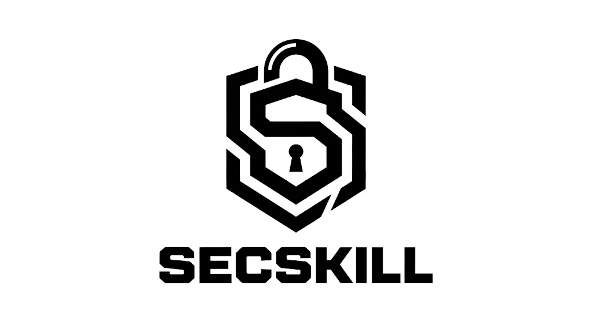

<p align="center">
  
</p>

<h1 align="center">SecSkill</h1>

<p align="center">
  <strong>Omni-Agent Security Reviewer & Full-Stack (SAST / DAST / AI-Agent) Audit Engine</strong>
</p>

<div align="center">

[-00ff88?style=flat-square&logo=github-actions&logoColor=white)](https://github.com/anasahmed67/sec-skill/actions)
[](https://modelcontextprotocol.io/)
[](https://www.python.org/)
[](LICENSE)
[](https://sarifweb.azurewebsites.net/)
[-dc2626?style=flat-square&logo=owasp&logoColor=white)](https://owasp.org/www-project-top-ten/)
[](https://cwe.mitre.org/top25/)
[-2563eb?style=flat-square)](https://csrc.nist.gov/Projects/ssdf)
[](https://www.iso.org/standard/27001)

</div>

---

<div align="center">

[**Why SecSkill?**](#-why-secskill) •
[**Quickstart & Setup**](#-quickstart--omni-agent-installation) •
[**Agent Skills & Slash Commands**](#-agent-skills--slash-commands) •
[**CLI Command Reference**](#-cli-command-reference) •
[**Model Context Protocol (MCP)**](#-model-context-protocol-mcp-server) •
[**Visual Attack Map & UI**](#-visual-attack-map--antigravity-generative-ui) •
[**Red vs. Blue Duel Arena**](#-autonomous-ai-red-team-vs-blue-team-duel-arena) •
[**Python SDK**](#-python-sdk--programmatic-api) •
[**8-Stage Pipeline**](#-the-8-stage-security-verification-pipeline) •
[**Standards Matrix**](#-international-security-standards-matrix) •
[**CI/CD Integration**](#-cicd--github-code-scanning-integration)

</div>

---

## 🛡️ Why SecSkill?

As AI coding assistants (**Google Antigravity, Cursor, Claude Code, GitHub Copilot, OpenAI Codex**) accelerate software delivery, they consistently introduce subtle security vulnerabilities. Traditional linters only check surface syntax, while standard LLM self-reviews suffer from systemic confirmation bias and hallucinated fixes.

**SecSkill** is an agent-native application security reviewer and static/dynamic analysis engine engineered specifically to eliminate these blind spots. It bridges the gap between AI autonomy and deterministic application defense, operating as both a **universal multi-agent skill** and a **standalone terminal security suite**.

### What AI Coding Agents Miss (and How SecSkill Solves It)

| What AI Agents Typically Miss | Why LLMs Miss It | How SecSkill Neutralizes It |
| :--- | :--- | :--- |
| **BOLA / IDOR Authorization Flaws** | LLMs assume called methods are authorized; they omit tenant filters (e.g., missing `user_id=current_user.id`). | **Deterministic AST dataflow analysis** flags unconstrained database reads, updates, and writes. |
| **Live Website & Infrastructure Flaws** | LLMs evaluate isolated code blocks, blind to runtime network ciphers, CORS policies, or missing headers. | **Built-in DAST URL Scanner (`scan-url`)** audits TLS/SSL, CSP, HSTS, CORS, and cookie flags. |
| **Transitive Dependency CVEs** | LLMs inspect source syntax, ignoring lockfile vulnerabilities or malicious upstream package versions. | **SCA Engine (`dep_scan.py`)** audits package manifests against Google OSV and vulnerability DBs. |
| **Hallucinated or Bypassed Fixes** | LLMs frequently write naive regex filters (e.g. stripping `<script>`) that attackers trivially bypass. | **Verified Remediation Engine** applies virtual patches and re-scans for **zero regressions**. |
| **Prompt Injection & AI Tool Abuse** | Repositories and MCP servers can harbor hidden prompt injections and over-privileged tools. | **Agent Security Auditor (`audit-agent`)** audits prompts, MCP tools, and LLM permissions. |

---

### Comparison: SecSkill vs. Legacy Security Tools

<div align="center">

| Capability | SecSkill | Semgrep (OSS) | Bandit | CodeQL | Snyk |
| :--- | :---: | :---: | :---: | :---: | :---: |
| **Omni-Agent Skill (Antigravity, Cursor, Claude, Codex)** | ✅ | ❌ | ❌ | ❌ | ❌ |
| **Standard Model Context Protocol (MCP) Server** | ✅ | ❌ | ❌ | ❌ | ❌ |
| **Live Website & API DAST Scanner (`scan-url`)** | ✅ | ❌ | ❌ | ❌ | ⚠️ |
| **Autonomous AI Red Team vs. Blue Team Duel Arena** | ✅ | ❌ | ❌ | ❌ | ❌ |
| **Differential Verified Patch Testing (Zero Regressions)** | ✅ | ❌ | ❌ | ❌ | ❌ |
| **AI Agent, Prompt & MCP Security Auditor** | ✅ | ❌ | ❌ | ❌ | ❌ |
| **Interactive Attack Map (HTML, Mermaid, Generative UI)** | ✅ | ❌ | ❌ | ⚠️ | ❌ |
| **Real-Time Desktop Secret Leak Watchdog** | ✅ | ❌ | ❌ | ❌ | ❌ |
| **SARIF 2.1.0 Export (GitHub Code Scanning)** | ✅ | ✅ | ❌ | ✅ | ✅ |
| **100% Local / Air-Gapped by Default** | ✅ | ⚠️ | ✅ | ❌ | ❌ |

</div>

---

## ⚡ Quickstart & Omni-Agent Installation

### 1. Install SecSkill CLI

Install SecSkill directly from PyPI or your local development repository:

```bash
# Standard installation
pip install secskill

# With optional local LLM acceleration dependencies
pip install "secskill[all]"
```

Verify the installation:

```bash
secskill version
```

---

### 2. Universal Omni-Agent Setup (`secskill init`)

SecSkill features a single-command universal installer that configures skills, rule sets, MCP servers, and CI workflows across all modern AI coding assistants:

```bash
# Initialize across ALL agent platforms simultaneously
secskill init --agent all
```

Or target a specific AI coding assistant:

```bash
secskill init --agent antigravity  # Configures Google Antigravity (.gemini/skills & plugin.json)
secskill init --agent claude       # Configures Claude Code (.claude/skills, rules.md, CLAUDE.md)
secskill init --agent cursor       # Configures Cursor (.cursor/rules/secskill.mdc & .cursor/mcp.json)
secskill init --agent codex        # Configures OpenAI Codex / Windsurf (.mcp/secskill.json & AGENTS.md)
```

#### What Gets Configured Per Platform:

* **Google Antigravity (AGY):** Installs `.gemini/skills/secskill/SKILL.md` and plugin manifest `.gemini/plugins/secskill/plugin.json`.
* **Anthropic Claude Code & Claude Desktop:** Installs `.claude/skills/secskill/SKILL.md`, `.claude/rules.md`, and `CLAUDE.md`.
* **Cursor IDE:** Creates `.cursor/rules/secskill.mdc` (Cursor Rules 2.0 with YAML glob matching), `.cursor/mcp.json`, and legacy `.cursorrules`.
* **OpenAI Codex / Windsurf:** Creates `.mcp/secskill.json` and root `AGENTS.md`.
* **CI/CD:** Installs `.github/workflows/secskill.yml` for automated GitHub Code Scanning.

---

### 3. One-Command Self-Update & Agent Sync (`secskill update`)

Keep SecSkill and all installed AI agent configurations up to date without manual git clones or file copying:

```bash
secskill update
```

#### Update Options:

```bash
secskill update                   # Full update: Git pull + pip upgrade + agent skills sync
secskill update --skills-only     # Refresh agent skills & rules without touching Git or pip
secskill update --agent cursor    # Sync only a specific agent target (antigravity, claude, cursor, codex)
secskill update --no-global       # Skip synchronizing home directory global agent configs
secskill upgrade                  # Convenience alias for secskill update
```

---

## 🤖 Agent Skills & Slash Commands

When working inside modern AI coding agents like **Google Antigravity**, **Claude Code**, or **Cursor**, you have access to native slash commands and conversational triggers.

### Native Slash Commands

| Slash Command | Purpose | Underlying Engine |
| :--- | :--- | :--- |
| `/secscan` | Runs full static analysis across the repository and exports a SARIF report. | `secskill scan . --format sarif` |
| `/scan-url` | Prompts for a target URL and audits headers, CORS policies, cookies, and TLS/SSL ciphers. | `secskill scan-url <url>` |
| `/secpatch` | Automatically picks High and Critical findings, generates fixes, and verifies zero regressions. | `secskill_verify_patch` |
| `/secduel` | Pits Red Team vs. Blue Team AI agents in an autonomous code hardening duel. | `secskill duel <scenario>` |
| `/audit-pr` | Compares the current git branch against `main`, auditing only modified files for regressions. | `secskill scan --diff main` |

### Natural Language Conversational Triggers

You can also trigger SecSkill organically without memorizing commands:

```
"Review this pull request for security vulnerabilities before I merge."
"Audit https://staging.myapp.com for missing security headers, weak TLS, and exposed files."
"Verify this remediation patch for CWE-89 to ensure zero regressions."
"Audit our MCP server and system prompts for prompt injection vulnerabilities."
"Watch this directory for leaked secrets and notify me if any API key is pasted."
```

---

## 📖 CLI Command Reference

### Summary of Commands

| Command | Category | Description | Example |
| :--- | :--- | :--- | :--- |
| [`secskill scan`](#1-secskill-scan) | SAST & SCA | Audit code, directories, git diffs, or single files | `secskill scan . --diff main` |
| [`secskill scan-url`](#2-secskill-scan-url) | DAST & Web | Audit live websites and APIs for TLS, headers, CORS, cookies | `secskill scan-url https://example.com` |
| [`secskill duel`](#3-secskill-duel) | Autonomous Duel | Red Team vs. Blue Team automated code hardening battle | `secskill duel sqli --apply` |
| [`secskill audit-agent`](#4-secskill-audit-agent) | AI Defense | Audit AI prompts, tool definitions, and MCP configurations | `secskill audit-agent . --format html --open` |
| [`secskill graph`](#5-secskill-graph) | Attack Mapping | Generate source-to-sink visual attack dataflow diagrams | `secskill graph . --format html --open` |
| [`secskill watch`](#6-secskill-watch) | Secret Watchdog | Real-time directory monitoring with desktop notifications | `secskill watch ./src` |
| [`secskill simulate`](#7-secskill-simulate) | Exploit Simulation | Simulate attack payload execution vs hardened defense | `secskill simulate sqli` |
| [`secskill explain`](#8-secskill-explain) | Knowledge Base | Deep-dive explanation and attack simulation for any CWE/finding | `secskill explain --finding CWE-89` |
| [`secskill fix`](#9-secskill-fix) | Remediation | Generate and preview remediation diffs for findings | `secskill fix --finding F-1001 --dry-run` |
| [`secskill mcp`](#10-secskill-mcp) | Protocol Server | Launch stdio JSON-RPC 2.0 Model Context Protocol server | `secskill mcp` |
| [`secskill init`](#11-secskill-init) | Agent Setup | Initialize skills, rules, and MCP configs for AI agents | `secskill init --agent all` |
| [`secskill update`](#12-secskill-update) | Self-Updater | Pull latest code, refresh pip package, and sync all agent skills | `secskill update` |
| [`secskill version`](#13-secskill-version) | Utilities | Display current installed version | `secskill version` |

---

### Detailed Command Guides

#### 1. `secskill scan`

Executes deterministic SAST taint analysis, secret scanning, and software composition analysis (SCA).

```bash
# Basic scan of the current directory
secskill scan .

# Audit only files changed against main branch (PR mode)
secskill scan --diff main

# Scan a single file
secskill scan --file src/auth.py

# Export to SARIF for GitHub Code Scanning
secskill scan . --format sarif --output results.sarif

# Export to JSON, Markdown, or HTML
secskill scan . --format json -o findings.json
secskill scan . --format markdown -o report.md
secskill scan . --format html -o report.html

# Enable LLM contextual triage (filters false positives)
secskill scan . --llm --provider ollama

# Exclude specific folders or globs
secskill scan . --ignore "tests/*,migrations/*"

# Allow network queries for dependency checks against Google OSV
secskill scan . --consent
```

#### Options:
* `path`: Target directory or file path (defaults to `.`).
* `--format`, `-f`: Output format: `console`, `sarif`, `json`, `markdown`, `html`.
* `--output`, `-o`: File path to save report.
* `--diff`: Base git branch or commit to diff against (e.g. `main`).
* `--scope`: Scope of scan: `all` or `changed-files`.
* `--file`: Specific single file to audit.
* `--llm`: Enable LLM contextual triage.
* `--provider`: LLM Provider (`ollama`, `openai`, `anthropic`).
* `--consent`: Allow external network queries for dependency audits (OSV).
* `--ignore`, `-i`: Comma-separated paths or glob patterns to ignore.
* `--include-secskill`: Include SecSkill internal files in audit.

---

#### 2. `secskill scan-url`

Non-invasive runtime security audit for deployed web apps, staging environments, and APIs.

```bash
# Audit a public website or staging URL
secskill scan-url https://staging.example.com

# Audit with SARIF export for CI/CD
secskill scan-url https://example.com --format sarif -o web_audit.sarif

# Audit without sensitive path probing (fast mode)
secskill scan-url https://api.example.com --no-probes --timeout 5.0
```

#### Checks Performed:
* **TLS/SSL Encryption:** Certificate expiration (<14 days alert), deprecated protocol detection (TLS 1.0/1.1), cipher suite safety.
* **HTTP Security Headers:** CSP (`Content-Security-Policy`), HSTS (`Strict-Transport-Security`), XFO (`X-Frame-Options`), MIME Sniffing (`X-Content-Type-Options`), Information Disclosure (`Server`, `X-Powered-By`).
* **Cookie Flags:** `HttpOnly`, `Secure`, and `SameSite` flags on all `Set-Cookie` headers.
* **CORS Configurations:** Insecure wildcard origins (`*`) with credentials, reflected origins.
* **Sensitive File Exposure:** Probes for `/.env`, `/.git/HEAD`, `/actuator/health`, `/swagger.json`, `/openapi.json`.

---

#### 3. `secskill duel`

Autonomous AI Red Team vs. Blue Team combat arena. Pits an attacker agent against a defender agent in the terminal until the code is proven impenetrable.

```bash
# Duel on built-in scenario (sqli, cmdi, xss, path-traversal)
secskill duel sqli

# Duel on a specific project file and auto-apply the verified hardened fix
secskill duel src/api/users.py --apply

# Duel with custom round count and specific local LLM models
secskill duel cmdi --rounds 5 --red-model codellama --blue-model codellama --provider ollama

# Save verified hardened code to a separate file
secskill duel sqli --output hardened_users.py
```

---

#### 4. `secskill audit-agent`

Audits AI Agent architectures, MCP server configs, and system prompts against the **OWASP Top 10 for LLMs** and **MITRE ATLAS**.

```bash
# Audit current project and display terminal summary
secskill audit-agent .

# Generate interactive Cyberpunk HTML dashboard and open in browser
secskill audit-agent . --format html --open

# Export SARIF report of agent security flaws
secskill audit-agent . --format sarif --output agent_audit.sarif

# Filter by minimum severity
secskill audit-agent . --min-severity HIGH
```

#### Audited Categories:
* **LLM01 / CWE-74:** Direct & Indirect Prompt Injection risks, missing delimiter boundaries.
* **LLM02 / CWE-200:** Sensitive Information Disclosure in system prompts and agent instructions.
* **LLM07 / CWE-250:** Insecure Plugin & Tool Design (unconstrained shell access, arbitrary filesystem write/delete).
* **MCP Server Analysis:** Missing input schemas, credential leaks in tool configurations.
* **Trust Index Scoring:** Computes overall agent security score (0–100) and letter grade (A+ to F).

---

#### 5. `secskill graph`

Visualizes source-to-sink vulnerability dataflows.

```bash
# Launch interactive HTML visual attack map in your browser
secskill graph . --format html --open

# Generate Antigravity Generative UI Dashboard
secskill graph . --format dashboard -o dashboard.html

# Export GitHub-ready Mermaid sequence/flowchart diagrams
secskill graph . --format mermaid -o attack_path.mmd

# Render colorful terminal ASCII attack paths
secskill graph . --format terminal
```

---

#### 6. `secskill watch`

Background secret leak monitor. Watches project files in real-time. If an API key, private key, or password is accidentally pasted, SecSkill fires a native desktop notification and sound alert.

```bash
# Watch current directory with desktop popups and chime
secskill watch .

# Watch specific source folder with custom polling interval
secskill watch ./src --interval 0.25

# Silent mode (terminal output only, no OS notifications)
secskill watch . --no-notify --no-sound
```

* **Secret Redaction:** Any detected secret is automatically redacted (`AKIA...XYZ`) in terminal logs.
* **Detection Engine:** Combines 30+ regex patterns with high Shannon entropy analysis.

---

#### 7. `secskill simulate`

Demonstrates exploit payloads executing against vulnerable code and shows how SecSkill's recommended fix neutralizes the attack.

```bash
# List all available scenarios
secskill simulate --list

# Simulate SQL Injection exploit vs parameterized query
secskill simulate sqli

# Simulate Command Injection exploit vs safe subprocess list
secskill simulate cmdi

# Simulate Path Traversal, SSRF, XSS, or Prompt Injection
secskill simulate path-traversal
secskill simulate ssrf
secskill simulate prompt-injection
```

---

#### 8. `secskill explain`

Returns deep MITRE CWE, OWASP, and compliance context for any finding or vulnerability class:

```bash
secskill explain --finding CWE-89
secskill explain --finding CWE-78
```

---

#### 9. `secskill fix`

Generates unified diff remediation previews for discovered vulnerabilities:

```bash
# Preview fix diff without modifying files (dry run)
secskill fix --finding F-1001 --dry-run

# Apply verified remediation
secskill fix --finding F-1001 --no-dry-run
```

---

#### 10. `secskill mcp`

Launches the Model Context Protocol server over standard input/output (`stdio`) for seamless integration into any AI assistant:

```bash
secskill mcp
```

---

## 🔌 Model Context Protocol (MCP) Server

SecSkill implements the official open standard **Model Context Protocol (MCP) JSON-RPC 2.0** (`2024-11-05`), acting as the native security intelligence layer for AI coding agents.

```
┌────────────────────────────────────────────────────────┐
│  Host AI Agents (Antigravity, Cursor, Claude, Codex)   │
└───────────────────────────┬────────────────────────────┘
                            │ Standard JSON-RPC over stdio
┌───────────────────────────▼────────────────────────────┐
│                  SecSkill MCP Server                   │
├────────────────────────────────────────────────────────┤
│ • secskill_scan         • secskill_verify_patch        │
│ • secskill_scan_url     • secskill_audit_agent         │
│ • secskill_explain      • secskill_attack_map          │
│ • secskill_duel                                        │
└────────────────────────────────────────────────────────┘
```

### Adding SecSkill to Your MCP Client

#### Anthropic Claude Desktop (`claude_desktop_config.json`):
```json
{
  "mcpServers": {
    "secskill": {
      "command": "secskill",
      "args": ["mcp"]
    }
  }
}
```

#### Cursor IDE (`.cursor/mcp.json`):
```json
{
  "mcpServers": {
    "secskill": {
      "command": "secskill",
      "args": ["mcp"]
    }
  }
}
```

#### Google Antigravity (`mcp_config.json`):
```json
{
  "mcpServers": {
    "secskill": {
      "command": "secskill",
      "args": ["mcp"]
    }
  }
}
```

---

### Exposed MCP Tools Catalog

| Tool Name | Parameters | Description |
| :--- | :--- | :--- |
| `secskill_scan` | `path`, `diff`, `file`, `ignore`, `include_secskill` | Scans codebase, directories, git diffs, or specific files for vulnerabilities. |
| `secskill_scan_url` | `url`, `check_sensitive_paths` | Audits live websites and APIs for TLS, security headers, CORS, cookies, and sensitive exposure. |
| `secskill_verify_patch` | `file_path`, `proposed_patch`, `original_code` | Safely evaluates proposed code in an isolated virtual sandbox, confirming remediation with **0 regressions**. |
| `secskill_audit_agent` | `path`, `ignore`, `include_secskill` | Audits AI agent prompts, tool definitions, and MCP configurations for OWASP LLM vulnerabilities. |
| `secskill_explain` | `query` (CWE or Finding ID) | Returns attack path simulations, technical impact, and international compliance remediation advice. |
| `secskill_attack_map` | `path`, `output`, `min_severity`, `include_secskill` | Generates an interactive HTML Visual Attack Map with 1-click remediation drawer and ELI5 explanations. |
| `secskill_duel` | `target`, `rounds`, `apply` | Runs an autonomous Red Team vs. Blue Team duel arena until target code is proven hardened. |

---

## 🗺️ Visual Attack Map & Antigravity Generative UI

SecSkill features a zero-dependency, ultra-fast vector attack graph generator (`secskill graph . --format html --open`):

<p align="center">
  
  
  
</p>

### 4-Tier Visual Architecture:
1. **Tier 1 (Cyan) — Untrusted Public Entrypoints:** HTTP routes, `req.body`, query params, uploaded files.
2. **Tier 2 (Purple) — Application Source Modules:** Controller files, middleware, route handlers (`.py`, `.ts`, `.js`, `.go`).
3. **Tier 3 (Severity-Coded) — Execution Sinks:** Unsanitized database executions, raw shell calls (`subprocess`), HTML template sinks.
4. **Tier 4 (Crimson) — Crown Jewel Assets:** Production Database, Host Operating System Shell, Secrets Vault.

### Interactive Features:
* **Animated Laser Exploit Paths:** Glowing, pulsating attack vectors tracing the adversary's journey.
* **Clickable Remediation Inspector Drawer:** Clicking any vulnerability opens an instant drawer containing:
  * Exact line numbers and source file path.
  * **ELI5 ("Explain Like I'm 5"):** Plain-English, jargon-free real-world analogy.
  * Tested parameterized remediation code with a 1-click **"Copy Fix"** button.
* **Antigravity Generative UI Dashboard:** Self-contained widget (`--format dashboard`) optimized for embedding directly inside Google Antigravity chat sessions.

---

## ⚔️ Autonomous AI Red Team vs. Blue Team Duel Arena

The **Duel Arena** (`secskill duel`) pits two autonomous AI agent roles against each other to harden vulnerable code:

```
┌────────────────────────────────────────────────────────┐
│                   SECSKILL ARENA                       │
├───────────────────────────┬────────────────────────────┤
│   🔴 Red Team Attacker    │    🔵 Blue Team Defender   │
│   Crafts bypass payloads: │    Hardens code structure: │
│   - Multi-encoding        │    - Prepared statements   │
│   - Tautology injection   │    - Type constraints      │
│   - Out-of-band tricks    │    - Boundary validation   │
├───────────────────────────┴────────────────────────────┤
│            🛡️ SecSkill AST & Taint Verifier            │
│            Determines Penetration vs Hardened          │
└────────────────────────────────────────────────────────┘
```

1. **Round 1:** Red Team generates advanced evasion payloads targeting the initial code.
2. **Round 2:** Blue Team writes an AST-safe remediation.
3. **Round 3:** SecSkill's deterministic verifier checks if the code is hardened. If any bypass succeeds, combat continues.
4. **Victory:** Once Blue Team completely seals all attack vectors with 0 regressions, passing `--apply` automatically overwrites your target file with the verified hardened code.

---

## 🐍 Python SDK / Programmatic API

Use SecSkill directly in custom Python scripts, agent loops, or automated testing suites:

```python
from secskill.agent_skill import SecSkillAgentSkill

# 1. Initialize skill
skill = SecSkillAgentSkill(target_dir=".")

# 2. Run source code security scan
findings = skill.run_security_scan("src/api/users.py")
for f in findings:
    print(f"[{f['severity']}] {f['title']} ({f['cwe_id']}) at line {f['line_number']}")

# 3. Audit a live website or API (DAST)
web_report = skill.scan_url("https://example.com", check_sensitive_paths=True)
print(f"Status: {web_report['status_code']} | Findings: {len(web_report['findings'])}")

# 4. Verify a proposed remediation patch (Differential Regression Detection)
verification = skill.verify_remediation(
    file_path="src/api/users.py",
    proposed_patch='cursor.execute("SELECT * FROM users WHERE id = ?", (user_id,))',
    original_code='cursor.execute(f"SELECT * FROM users WHERE id = {user_id}")'
)
print(f"Verdict: {verification['status']} - {verification['message']}")
# Output: PASS - Remediation successfully verified. 1 finding(s) neutralized with 0 regressions.

# 5. Audit AI Agent prompts & MCP configs
agent_audit = skill.audit_agent(".")
print(f"Trust Index: {agent_audit['security_score']}/100 (Grade {agent_audit['grade']})")
```

---

## ⚙️ The 8-Stage Security Verification Pipeline

When invoked, SecSkill executes an 8-stage verification pipeline:

```
[Stage 0: Scope & Privacy] ──> [Stage 1: Repo Indexing] ──> [Stage 2: Parallel Scanners]
                                                                     │
[Stage 5: Validation Filter] <── [Stage 4: LLM Context] <─── [Stage 3: Normalization]
       │
       └──> [Stage 6: Multi-Format Reporting] ──> [Stage 7: Remediate & Re-scan]
```

1. **Stage 0: Scope & Privacy:** Enforces local air-gapped privacy boundaries and respects `.secskillignore`.
2. **Stage 1: Repo Indexing:** Indexes application entry points, routing tables, and dependency lockfiles.
3. **Stage 2: Parallel Scanners:** Concurrently executes AST taint analyzers, secret scanners, dependency CVE auditors, and DAST probes.
4. **Stage 3: Normalization:** Normalizes all findings into the unified schema with CVSS v3.1 severities, CWE IDs, and OWASP categories.
5. **Stage 4: LLM Contextual Review:** (Optional `--llm`) Leverages local LLMs to eliminate false positives in complex contexts.
6. **Stage 5: Validation Filter:** Validates reachability and respects in-code `# secskill:ignore` directives.
7. **Stage 6: Multi-Format Reporting:** Generates Console tables, SARIF 2.1.0, JSON, Markdown, or HTML dataflow maps.
8. **Stage 7: Remediate & Re-scan:** Applies virtual patches in a sandbox, confirming neutralization with zero regressions.

---

## 🏛️ International Security Standards Matrix

Every finding generated by SecSkill carries bidirectional traceability to international security frameworks:

| Framework / Standard | Version | Coverage & Mapping in SecSkill |
| :--- | :--- | :--- |
| **OWASP Top 10** | 2021 | Mapped to `A01:2021` through `A10:2021` on all source code and website findings. |
| **OWASP API Security Top 10** | 2023 | Specialized API checks for BOLA (`API1:2023`), Broken Auth (`API2:2023`), and SSRF (`API7:2023`). |
| **OWASP Top 10 for LLMs** | 2025 | Mapped in `secskill audit-agent` (LLM01 Prompt Injection, LLM02 Sensitive Disclosure, LLM07 Insecure Plugin Design). |
| **MITRE CWE / SANS Top 25** | v4.14 | Exact CWE ID assigned to every finding (`CWE-89`, `CWE-78`, `CWE-79`, `CWE-319`, `CWE-1021`, etc.). |
| **NIST SP 800-218 (SSDF)** | v1.1 | Practice mapping: `PO` (Prepare Org), `PS` (Protect Software), `PW` (Produce Well-Secured Software), `RV` (Respond to Vulns). |
| **NIST SP 800-53 Rev 5** | Controls | Controls mapping: `SC-8` (Transmission Confidentiality), `SI-10` (Input Validation), `AC-3` (Access Enforcement). |
| **ISO/IEC 27001:2022** | Annex A.8 | Controls: `A.8.20` (Network Security), `A.8.24` (Cryptography), `A.8.26` (App Security), `A.8.28` (Secure Coding). |
| **PCI-DSS** | v4.0 | Requirement 6: `6.2` (Software Development), `6.3` (Identify & Mitigate Vulns), `6.4` (Protect Web Applications). |
| **OASIS SARIF** | v2.1.0 | Full native SARIF export for GitHub Code Scanning and GitLab SAST. |

---

## 🛠️ CI/CD & GitHub Code Scanning Integration

SecSkill integrates seamlessly with GitHub Actions to publish findings directly into the **GitHub Security Tab**:

`.github/workflows/secskill.yml`:

```yaml
name: SecSkill Security Scan

on:
  pull_request:
    branches: [main]
  push:
    branches: [main]

jobs:
  secskill:
    name: SecSkill SAST Scan
    runs-on: ubuntu-latest
    permissions:
      security-events: write
      contents: read
    steps:
      - name: Checkout Code
        uses: actions/checkout@v4

      - name: Set up Python
        uses: actions/setup-python@v5
        with:
          python-version: "3.11"

      - name: Install SecSkill
        run: pip install secskill

      - name: Run SecSkill Scan
        run: secskill scan . --format sarif --output secskill.sarif

      - name: Upload SARIF to GitHub Code Scanning
        uses: github/codeql-action/upload-sarif@v3
        if: always()
        with:
          sarif_file: secskill.sarif
```

---

## ⚙️ Configuration & Customization

### Ignoring Files (`.secskillignore`)

Create a `.secskillignore` file in your repository root to exclude paths from scans:

```gitignore
tests/
venv/
node_modules/
dist/
*.min.js
```

### In-Code Rule Suppression

To ignore a specific finding on a line, add a `# secskill:ignore` comment:

```python
# secskill:ignore CWE-89
cursor.execute(f"SELECT * FROM static_table WHERE status = '{trusted_status}'")
```

---

## 🤝 Contributing

We welcome community contributions, custom rule packs, and framework additions!

1. Fork the repository: `https://github.com/anasahmed67/sec-skill`
2. Create a feature branch: `git checkout -b feature/awesome-rule`
3. Add tests in `tests/`
4. Ensure all tests pass: `pytest`
5. Format code: `ruff check . --fix`
6. Submit a Pull Request

Please review [CONTRIBUTING.md](CONTRIBUTING.md) and [CODE_OF_CONDUCT.md](CODE_OF_CONDUCT.md) for details.

---

## 📄 License

SecSkill is open-source software licensed under the [Apache License 2.0](LICENSE).
