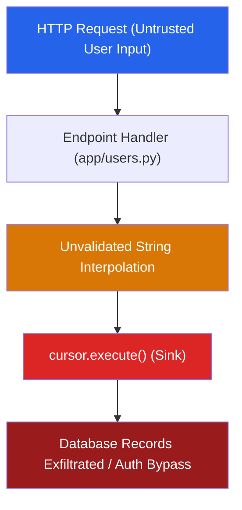

<div align="center">

# SecSkill

### Agent-Native Security Reviewer & Static Analysis Engine for AI and Human Code

[](https://github.com/secskill/secskill/actions/workflows/ci.yml)
[](https://opensource.org/licenses/Apache-2.0)
[](https://www.python.org/downloads/)
[](https://github.com/astral-sh/ruff)
[](https://oasis-open.github.io/sarif-spec/)
[-orange.svg)](https://owasp.org/Top10/)
[](https://cwe.mitre.org/top25/)
[](https://csrc.nist.gov/pubs/sp/800/218/final)

<p align="center">
  <a href="#overview">Overview</a> &bull;
  <a href="#why-secskill">Why SecSkill?</a> &bull;
  <a href="#installation">Installation</a> &bull;
  <a href="#quickstart">Quickstart</a> &bull;
  <a href="#visual-reports--dashboard">Visual Reports</a> &bull;
  <a href="#integrations-antigravity--cursor">Agent Integrations</a> &bull;
  <a href="#cli-reference">CLI Reference</a> &bull;
  <a href="#cicd-integration">CI/CD</a> &bull;
  <a href="#benchmarks--accuracy">Benchmarks</a> &bull;
  <a href="#privacy--security">Privacy & Security</a>
</p>

---

</div>

## Overview

**SecSkill** is an open-source, agent-native application security reviewer and static analysis engine designed for modern software development. It bridges the gap between high-speed static analysis (AST parsing, taint heuristics, pattern-based secret scanning) and deep contextual verification (LLM-assisted triage) to detect critical vulnerabilities in both human-written and AI-generated code without generating false-positive fatigue.

### Operational Modes

- **Developer CLI:** Fast local security scans, Git PR diff audits, real-time secret leak monitoring, and interactive attack simulations.
- **Interactive Web Dashboard:** Standalone dark-mode HTML security reports featuring letter grades (A+ through F), a 0 to 100 risk score, and source-to-sink dataflow visualizers.
- **Native AI Agent Skill:** Direct integration into **Google Antigravity**, **Cursor**, **Claude Code**, and autonomous agent pipelines to ensure AI coding tools verify code before committing.
- **CI/CD Code Scanning:** Generation of **SARIF 2.1.0** reports for direct ingestion into GitHub Advanced Security and Code Scanning alerts.

---

## Terminal Preview

```text
$ secskill scan ./src --format console

                       SecSkill Security Scan Summary (Found: 2)
+----------+-----------------+-----------------+------------------------------------+
| Severity | Rule ID         | Location        | Title                              |
+----------+-----------------+-----------------+------------------------------------+
| CRITICAL | SEC-089-SQLI    | app/users.py:42 | SQL Injection via f-string         |
| CRITICAL | SEC-798-AWS-KEY | config.py:14    | Exposed Credential: AWS Access Key |
+----------+-----------------+-----------------+------------------------------------+

[CRITICAL] SQL Injection via String Formatting
  Location: app/users.py:42
  CWE: CWE-89 | OWASP: A03:2021-Injection | SSDF: PW.5.1
  Attack Path: HTTP parameter 'user_id' reaches cursor.execute() unparameterized.
  Remediation: Use parameterized queries with bound placeholders:
    - cursor.execute(f"SELECT * FROM users WHERE id = {user_id}")
    + cursor.execute("SELECT * FROM users WHERE id = ?", (user_id,))

[CRITICAL] Exposed Credential: AWS Access Key
  Location: config.py:14
  Value: AKIA...49D  [REDACTED]
  Remediation: Invalidate key in AWS IAM and load from AWS Secrets Manager.
```

---

## Why SecSkill?

With the widespread adoption of AI coding assistants (such as Copilot, Cursor, Antigravity, and Claude Code), developers generate software at historic velocity. However, AI assistants introduce specific failure modes: hallucinated dependencies, missing server-side authorization checks, client-side permission enforcement, and prompt injection sinks.

Traditional SAST tools generate excessive false positives on modern frameworks, while querying raw cloud LLMs exposes proprietary code, leaks credentials, and fails to evaluate reachability deterministically.

| Capability / Dimension | Traditional SAST (Sonar / Semgrep) | Raw LLM Prompt ("Is this safe?") | SecSkill |
|:---|:---:|:---:|:---:|
| **False Positive Fatigue** | High (flags dead code and safe templates) | Medium (hallucinates theoretical flaws) | **Ultra-Low** (contextual validation filter) |
| **Code Privacy** | High (local execution) | None (transmits code to external APIs) | **100% Local by Default** (explicit consent required) |
| **Secret Protection** | Regex only (often exposes tokens in logs) | Often repeats detected secrets in chat | **Deterministic Redaction** (`AKIA...XYZ`) |
| **Agent Integration** | Rigid CLI output, non-semantic formats | Unstructured natural language | **Agent-Native** (structured schemas and tool contracts) |
| **AI Anti-Patterns** | Misses prompt sinks and logic hallucinations | Vulnerable to prompt injection escapes | **Detects AI Sinks & Defends Against Jailbreaks** |
| **Dataflow Visualization** | Requires paid enterprise subscriptions | Not available | **Built-in Mermaid, Terminal & HTML Graphs** |
| **CI/CD Output** | Varies by vendor | Not available | **Native SARIF 2.1.0 (GitHub Code Scanning)** |
| **Security Scoring** | Raw finding count | Not available | **0 to 100 Score with A+ to F Letter Grade** |

---

## Key Features

- **Dual-Engine Precision:** Combines deterministic AST and regex matching with optional LLM contextual triage (Ollama, OpenAI, Anthropic) to evaluate exploitability.
- **Interactive Web Dashboard (`secskill view`):** Instant dark-mode HTML report with radial score gauge (0 to 100), letter grade (A+ through F), severity filters, and code diff previews.
- **Visual Attack Path Graphing (`secskill graph`):** Traces dataflow step-by-step from untrusted source to route handler, flaw, sink, and blast radius in Terminal, HTML, or Mermaid formats.
- **Real-Time Secret Watchdog (`secskill watch`):** Background filesystem watcher utilizing Shannon entropy calculations to identify credentials and alert developers via desktop notifications and audio chimes.
- **Defensive Attack Simulator (`secskill simulate`):** Educational CLI sandbox comparing vulnerable code execution, attack payloads, and parameterized defenses.
- **Agent-First Architecture:** Pre-configured rule templates and tool contracts for Google Antigravity, Cursor, Claude Code, and custom autonomous agents.
- **Privacy by Design:** Zero external network transmission by default, automatic credential redaction, safe benign-only validation tests, and prompt injection defense (CWE-74).
- **Standards Grounded:** Built directly upon **OWASP Top 10 (2021)**, **MITRE CWE Top 25**, and **NIST SP 800-218 SSDF** practices.

---

## Installation

SecSkill requires **Python 3.10** or higher.

### Standard Installation

Install directly from source or local checkout:

```bash
# Clone the repository
git clone https://github.com/secskill/secskill.git
cd secskill

# Install in editable mode
pip install -e .
```

### Optional LLM Provider Extras

SecSkill executes 100% locally by default using built-in rule engines and local **Ollama** instances (no additional packages required). To enable cloud model providers, install the corresponding extras:

```bash
# OpenAI support (GPT-4o, O3-mini)
pip install ".[openai]"

# Anthropic support (Claude 3.5 Sonnet)
pip install ".[anthropic]"

# Install all optional providers and development tools
pip install ".[all,dev]"
```

Verify the installation:

```bash
secskill version
```

---

## Quickstart

### 1. Run a Security Scan

```bash
# Scan the current repository
secskill scan .

# Scan a specific file
secskill scan --file src/api/users.py

# Scan only files modified in your Git branch (pre-PR check)
secskill scan --diff main

# Scan with LLM contextual verification (using local Ollama or cloud provider)
secskill scan . --llm --provider ollama
```

### 2. Export Standard Report Formats

```bash
# Standard console output (default)
secskill scan . --format console

# Export SARIF 2.1.0 for GitHub Code Scanning
secskill scan . --format sarif --output secskill.sarif

# Export structured JSON
secskill scan . --format json --output report.json

# Export GitHub-Flavored Markdown
secskill scan . --format markdown --output security_audit.md

# Export standalone HTML report
secskill scan . --format html --output report.html
```

---

## Visual Reports & Dashboard

### Interactive Web Dashboard (`secskill view`)

Launch an interactive, dark-mode security report in your default browser with a single command:

```bash
secskill view .
```

```text
Starting SecSkill scan for visual dashboard: .
Dashboard generated at: C:\Users\...\secskill_dashboard_a1b2c3d4.html
Opening visual dashboard in default browser...
```

**Dashboard Capabilities:**
- **Executive Scorecard:** 0 to 100 overall Security Score with letter grading (`A+`, `A`, `B`, `C`, `F`).
- **Severity Breakdown:** Filterable counters for Critical, High, Medium, and Low findings.
- **Full-Text Filter:** Instant client-side search by CWE, rule name, or file path.
- **Unified Diff Viewer:** Line-by-line syntax-highlighted remediations showing exactly how to patch vulnerabilities.

---

### Attack Path Dataflow Graphing (`secskill graph`)

Trace dataflow from untrusted entrypoints to dangerous sinks:

```bash
# Render ASCII dataflow steps directly in your terminal
secskill graph ./src --format terminal

# Export Mermaid diagram for documentation or pull request descriptions
secskill graph ./src --format mermaid --output attack_path.mmd

# Generate interactive HTML diagram and open in browser
secskill graph ./src --format html --open
```

#### Terminal Dataflow Output

```text
+--------------------- SecSkill Visual Dataflow Graph ---------------------+
| Attack Path Dataflow: SQL Injection via Interpolated Query Variable      |
| CWE: CWE-89 | Location: app/users.py:42                                  |
+--------------------------------------------------------------------------+
  1. Entrypoint (Source):
     [->] HTTP Request (query/body parameter)
          Data type: Untrusted User Input
  2. Processing (Route):
     [->] Endpoint Handler (app/users.py)
          Request routing & parameter parsing
  3. Security Flaw:
     [->] String Interpolation / Missing Parameter Binding
          Validation Missing
  4. Execution (Sink):
     [->] cursor.execute() (app/users.py:42)
          Code: cursor.execute(f"SELECT * FROM users WHERE id = {user_id}")
  5. Blast Radius:
     [->] Database Records Exfiltrated / Authentication Bypass
```

#### Mermaid Flowchart Output



---

## Real-Time Secret Watchdog (`secskill watch`)

Monitor files in real time during active development. When a developer or AI autocomplete accidentally pastes credentials, `secskill watch` triggers an operating system notification and audio chime before changes are committed:

```bash
# Watch current directory with desktop alerts and sound
secskill watch .

# Watch silently without audio chime
secskill watch ./src --no-sound

# Adjust scanning interval (default: 0.5s)
secskill watch . --interval 1.0
```

- **Supported Credentials:** AWS Access & Secret Keys, GitHub Personal Access Tokens, OpenAI / Anthropic API keys, Google Cloud Service Account keys, Slack Bot Tokens, Stripe Secret Keys, Private RSA/SSH keys, JWT secrets.
- **Entropy Heuristics:** Shannon entropy thresholds eliminate false alarms on mock and placeholder strings (`my_secret`, `changeme`, `dummy_key`).

---

## Defensive Attack Simulator (`secskill simulate`)

SecSkill provides an interactive CLI simulator demonstrating how common vulnerabilities execute under attacker payloads and how secure remediations neutralize them:

```bash
# List all available simulation scenarios
secskill simulate --list

# Simulate SQL Injection attack and defense
secskill simulate sqli

# Simulate OS Command Injection attack and defense
secskill simulate cmdi

# Simulate LLM Prompt Injection and boundary isolation
secskill simulate prompt-injection
```

**Supported Scenarios:**
- `sqli` — SQL Injection (CWE-89 / OWASP A03)
- `cmdi` — OS Command Injection (CWE-78 / OWASP A03)
- `xss` — Cross-Site Scripting (CWE-79 / OWASP A03)
- `path-traversal` — Path Traversal (CWE-22 / OWASP A01)
- `ssrf` — Server-Side Request Forgery (CWE-918 / OWASP A10)
- `prompt-injection` — LLM Prompt Injection & Role Hijacking (CWE-74 / OWASP LLM01)

---

## Remediation & Triage

### Deep Vulnerability Explanation (`secskill explain`)

Obtain MITRE CWE context, attack simulation details, and standard mitigations:

```bash
secskill explain --finding CWE-89
```

### Dry-Run Code Remediation (`secskill fix`)

Preview code fixes before applying modifications to disk:

```bash
# Preview diff safely without altering files
secskill fix --finding F-1001 --dry-run

# Apply remediation once verified
secskill fix --finding F-1001 --no-dry-run
```

---

## Integrations: Antigravity & Cursor

SecSkill is designed for direct integration into AI coding environments.

### 1. Using SecSkill in Google Antigravity

Antigravity uses native agent skills (`SKILL.md`) to allow the assistant to audit code, trace attack paths, and verify patches during pair-programming sessions.

#### Setup for Workspace or Global Use

Ensure `secskill` is installed in your active Python environment:
```bash
pip install -e .
```

Register the skill with Antigravity:

```bash
# Option A: Register for the current project workspace
mkdir -p .gemini/skills/secskill
cp secskill/SKILL.md .gemini/skills/secskill/SKILL.md

# Option B: Register globally for all projects on your machine
mkdir -p ~/.gemini/config/skills/secskill
cp secskill/SKILL.md ~/.gemini/config/skills/secskill/SKILL.md
```

#### How to Use in Antigravity Chat

Antigravity detects when a request relates to code security, vulnerability assessment, or pull request review, invoking SecSkill tools autonomously. Example user prompts:

- **Reviewing a specific file:**
  > *"Audit `app/routes.py` with SecSkill and verify if there are any SQL injection or authentication bypass issues."*
- **Verifying a pull request diff:**
  > *"Run `secskill scan --diff main` and report any Critical or High findings introduced in this branch."*
- **Generating attack path diagrams:**
  > *"Trace the untrusted dataflow for the SQL injection finding using `secskill graph`."*
- **Opening the security dashboard:**
  > *"Run `secskill view .` to inspect the visual dashboard."*

---

### 2. Using SecSkill in Cursor

Cursor uses `.cursorrules` in your project root to instruct the AI model on coding constraints, security standards, and terminal commands.

#### Step 1: Initialize Project Configuration

Run the project initialization command:

```bash
secskill init
```

This command automatically generates:
- `.cursorrules` — Security guidelines and command execution triggers for Cursor.
- `.secskill/AGENT.md` — Behavioral instructions for autonomous agents.
- `.secskill/rules.md` — Rule references mapped to CWE and OWASP categories.
- `.secskill/policies.md` — Zero-trust privacy and verification policies.
- `.github/workflows/secskill.yml` — Pre-configured GitHub Actions scanning workflow.

#### Step 2: Cursor Rules Reference (`.cursorrules`)

The generated `.cursorrules` instructs Cursor to enforce secure practices and run validation checks:

```markdown
# SecSkill Security Reviewer Guidelines for Cursor

## Secure Coding Constraints:
1. Parameterize all database queries (never use string formatting or f-strings in SQL).
2. Subprocess calls must use discrete argument lists with shell=False.
3. Never hardcode credentials, secrets, or API keys (AWS, GitHub, JWT). Always use environment variables.
4. Enforce server-side role and tenant authorization checks on every database access (e.g., user_id=current_user.id).
5. For front-end code, avoid raw HTML injection (dangerouslySetInnerHTML, v-html) without DOMPurify sanitization.

## Tool Verification:
- When modifying backend endpoints, run: secskill scan --file <relative_path>
- Prior to finalizing branch changes, run: secskill scan --diff main
- To preview fixes: secskill fix --finding <ID> --dry-run
```

#### Step 3: How to Use in Cursor Chat & Composer (`Ctrl+L` / `Ctrl+K`)

- **Pre-Commit Audit:**
  > *"Run `secskill scan --diff main` in terminal and fix any flagged vulnerabilities."*
- **File Validation:**
  > *"Write a file download endpoint in FastAPI, then run `secskill scan --file app/api.py` to ensure it is protected against path traversal (CWE-22)."*
- **Active Secret Monitoring:**
  Open a split terminal in Cursor and run:
  ```bash
  secskill watch .
  ```
  The watcher monitors file changes continuously and alerts you immediately if a key is exposed.

---

### 3. Direct Python SDK Integration

Autonomous agents and custom scripts can invoke SecSkill programmatically via `SecSkillAgentSkill`:

```python
from secskill.agent_skill import SecSkillAgentSkill

# Initialize agent security skill
agent_skill = SecSkillAgentSkill(target_dir=".")

# Run scan on code generated by an AI model
findings = agent_skill.run_security_scan(file_path="src/api/auth.py")

# Verify proposed remediation patch
verification = agent_skill.verify_remediation(
    file_path="src/api/auth.py",
    proposed_patch="..."
)
print(verification["status"])  # Returns: PASS
```

---

## Architecture & The 8-Stage Pipeline

SecSkill runs an 8-stage audit pipeline designed to maximize detection fidelity while minimizing false alarms:

```
[Stage 0: Scope & Consent]
       |
       v
[Stage 1: Repository Indexing] (Entrypoints, routes, auth middleware)
       |
       v
[Stage 2: Parallel Scanning]
       +-- Static AST Rules (Python, JavaScript/TypeScript, Java)
       +-- Shannon Entropy Secret Scanner
       +-- Dependency Manifest Audit (OSV / Lockfiles)
       +-- Taint Dataflow Heuristics (Source-to-Sink)
       |
       v
[Stage 3: Unified Normalization] (CWE, OWASP Top 10, NIST SSDF)
       |
       v
[Stage 4: LLM Contextual Review] (Reachability & Exploitability Triage)
       |
       v
[Stage 5: Validation Filter] (Framework escaping & ORM validation check)
       |
       v
[Stage 6: Multi-Format Reporting] (Console, SARIF 2.1.0, HTML, JSON, Markdown)
       |
       v
[Stage 7: Remediate & Re-scan] (Unified diff preview with human approval)
```

---

## CLI Reference

```text
Usage: secskill [OPTIONS] COMMAND [ARGS]...
```

| Command | Options and Arguments | Description |
|:---|:---|:---|
| **`scan`** | `[PATH]` (default: `.`)<br>`-f, --format [console\|sarif\|json\|markdown\|html]`<br>`-o, --output PATH`<br>`--diff TEXT`<br>`--scope [all\|changed-files]`<br>`--file PATH`<br>`--llm / --no-llm`<br>`--provider [ollama\|openai\|anthropic]`<br>`--consent` | Run security audit on repository, git diff, or single file. |
| **`view`** | `[PATH]` (default: `.`)<br>`-o, --output PATH`<br>`--open / --no-open` | Audit codebase and immediately launch the visual interactive dark-mode Web Dashboard. |
| **`graph`** | `[PATH]` (default: `.`)<br>`-f, --format [terminal\|mermaid\|html]`<br>`--finding TEXT`<br>`-o, --output PATH`<br>`--open` | Generate visual source-to-sink Attack Path dataflow diagrams. |
| **`watch`** | `[PATH]` (default: `.`)<br>`--notify / --no-notify`<br>`--sound / --no-sound`<br>`--interval FLOAT` (default: 0.5) | Watch directory in real-time and trigger desktop alerts upon credential exposure. |
| **`simulate`** | `[SCENARIO]` (default: `sqli`)<br>`-l, --list` | Simulate how an attack payload executes in vulnerable code versus parameterized defense. |
| **`explain`** | `-f, --finding TEXT` (Required) | Explain finding with MITRE/OWASP context and attack simulation. |
| **`fix`** | `-f, --finding TEXT` (Required)<br>`--dry-run / --no-dry-run`<br>`-p, --path PATH` | Generate or preview remediation diff for a finding with human confirmation. |
| **`init`** | `-t, --target PATH` (default: `.`) | Initialize SecSkill agent rules, `.cursorrules`, and CI workflows in target project. |
| **`version`** | *(none)* | Display installed SecSkill version. |

---

## CI/CD Integration

SecSkill integrates into GitHub Actions workflows. Add `.github/workflows/secskill.yml` to automatically audit pull requests and upload results directly into **GitHub Security -> Code Scanning Alerts**:

```yaml
name: SecSkill Security Scan

on:
  pull_request:
    branches: [main]
  push:
    branches: [main]

jobs:
  security-audit:
    name: SecSkill SAST Scan
    runs-on: ubuntu-latest
    permissions:
      security-events: write
      contents: read
    steps:
      - name: Checkout Code
        uses: actions/checkout@v4

      - name: Set up Python
        uses: actions/setup-python@v5
        with:
          python-version: "3.11"

      - name: Install SecSkill
        run: pip install .

      - name: Run SecSkill Scan
        run: secskill scan . --format sarif --output secskill.sarif

      - name: Upload SARIF to GitHub Code Scanning
        uses: github/codeql-action/upload-sarif@v3
        if: always()
        with:
          sarif_file: secskill.sarif
```

---

## Benchmarks & Accuracy

SecSkill is evaluated against a curated benchmark suite consisting of **75 test cases** ([`benchmarks/ground_truth.json`](benchmarks/ground_truth.json)):

| Benchmark Category | Sample Count | Evaluated Scope | SecSkill Result |
|:---|:---:|:---|:---:|
| **Vulnerable Samples** | 30 | SQLi, Command Injection, Path Traversal, Deserialization, SSRF, XXE, ReDoS, CORS, Hardcoded Keys | **100% True Positive Rate** |
| **Secure Idiomatic Samples** | 30 | Parameterized queries, `shell=False`, JSX auto-escaping, safe path canonicalization | **0 False Positives** |
| **AI-Generated Anti-Patterns** | 15 | Hallucinated crypto ciphers, client-side role checks, naive regexes, missing auth gates | **100% Detection Rate** |

---

## Privacy & Security

1. **Local-First Processing:** All AST parsing, regex pattern matching, entropy checks, and dataflow tracing execute locally. No source code is sent to external APIs without explicit flags (`--llm`, `--consent`).
2. **Deterministic Credential Redaction:** Detected tokens and private keys are never written in full to reports or console output; they are masked to prefix and suffix identifiers (`AKIA...XYZ`).
3. **Prompt Injection Hardening:** Repository content (comments, docstrings, issue templates) containing prompt injection strings is detected under **CWE-74** and quarantined from hijacking agent instructions.
4. **Defensive Testing Boundaries:** Validation routines employ benign, non-weaponized inputs only. SecSkill will never generate offensive exploit payloads or attack tooling.

---

## Documentation Index

Detailed reference documentation is maintained in [`secskill/references/`](secskill/references/):

- [Agent Workflow Specification (`SKILL.md`)](secskill/SKILL.md) — Tool definitions and agent workflow contracts.
- [Taxonomy & Threat Model](secskill/references/taxonomy.md) — Vulnerability classifications and detectability hierarchy.
- [OWASP Top 10 Guide](secskill/references/owasp-top10.md) — Detection heuristics mapped to OWASP categories.
- [CWE Guidance](secskill/references/cwe-guidance.md) — Detailed remediation strategies per CWE.
- [Severity Rubric](secskill/references/severity-rubric.md) — CVSS estimation, scoring rubrics, and privilege downgrade rules.
- [NIST SSDF Mapping](secskill/references/ssdf-mapping.md) — Alignment with NIST SP 800-218 security practices.
- [Rule Authoring Guide](secskill/references/rule-authoring.md) — Guide for authoring custom YAML detection rules.
- [Language Packs](secskill/references/languages/) — Guidelines for [Python](secskill/references/languages/python.md), [JavaScript/TypeScript](secskill/references/languages/javascript-typescript.md), and [Java](secskill/references/languages/java.md).

---

## Contributing

Contributions are welcome. To get started:

```bash
# Clone repository
git clone https://github.com/secskill/secskill.git
cd secskill

# Install development dependencies
pip install -e ".[dev]"

# Execute test suite
pytest

# Run linter
ruff check .
```

All contributors are expected to adhere to our [Code of Conduct](CODE_OF_CONDUCT.md).

---

## Security Vulnerabilities

To report a vulnerability in SecSkill, please refer to our [Security Policy](SECURITY.md) and report via [GitHub Security Advisories](https://github.com/secskill/secskill/security/advisories/new) or contact **security@secskill.dev**.

---

## License

SecSkill is open-source software licensed under the [Apache License, Version 2.0](LICENSE).
