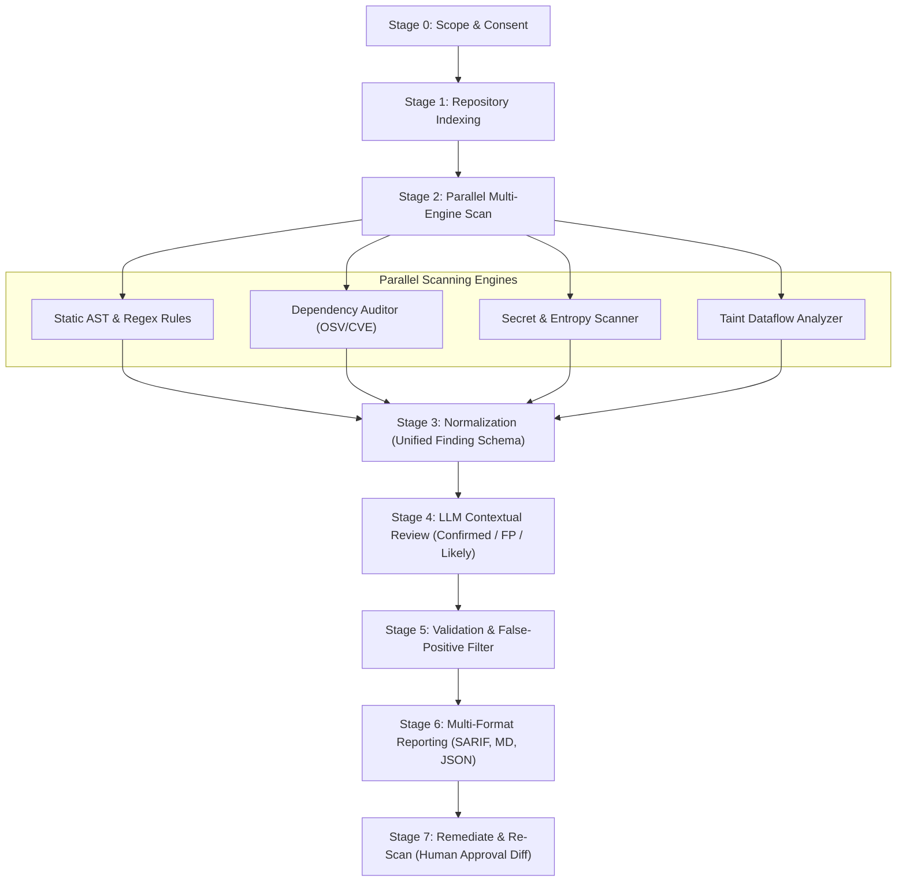

<div align="center">

# 🛡️ SecSkill

### The Agent-Native Application Security Reviewer for Human & AI-Generated Code

[](https://github.com/secskill/secskill/actions/workflows/ci.yml)
[](https://opensource.org/licenses/Apache-2.0)
[](https://www.python.org/downloads/)
[](https://github.com/astral-sh/ruff)
[](https://oasis-open.github.io/sarif-spec/)
[-orange.svg)](https://owasp.org/Top10/)
[](https://csrc.nist.gov/pubs/sp/800/218/final)

<p align="center">
  <a href="#-why-secskill">Why SecSkill?</a> •
  <a href="#-quickstart">Quickstart</a> •
  <a href="#-agent-integrations">Agent Integrations</a> •
  <a href="#-architecture--the-8-stage-pipeline">Architecture</a> •
  <a href="#-benchmarks--accuracy">Benchmarks</a> •
  <a href="#-cli-cheatsheet">CLI Reference</a> •
  <a href="#-security--privacy">Privacy</a>
</p>

---

</div>

## 📌 Overview

**SecSkill** is an open-source, agent-native security reviewer designed for modern software development. It bridges the gap between fast static analysis (AST/regex rules) and deep contextual verification (LLM triage) to catch critical vulnerabilities in human-written and AI-generated code without drowning developers in false positives.

It runs locally as a standalone CLI, integrates natively as an agent skill into **Claude Code**, **Cursor**, **Antigravity**, and **Claude.ai**, and publishes **SARIF 2.1.0** reports directly into GitHub Code Scanning alerts.

```
       ┌────────────────────────────────────────────────────────┐
       │                  SecSkill Pipeline                     │
Code ─►│ Indexing ─► Static/Secrets/Deps ─► LLM Triage ─► Filter │─► Actionable Report
       └────────────────────────────────────────────────────────┘
```

---

## ⚡ Terminal Preview

```
$ secskill scan ./src --format console

                       SecSkill Security Scan Summary (Found: 2)
+-----------------------------------------------------------------------------------------+
| Severity | Rule ID            | Location           | Title                              |
|----------+--------------------+--------------------+------------------------------------|
| CRITICAL | SEC-089-SQLI       | app/users.py:42    | SQL Injection via f-string         |
| CRITICAL | SEC-798-AWS-KEY    | config.py:14       | Exposed Credential: AWS Access Key |
+-----------------------------------------------------------------------------------------+

[CRITICAL] SQL Injection via String Formatting
  Location: app/users.py:42
  CWE: CWE-89 | OWASP: A03:2021-Injection | SSDF: PW.5.1
  Attack Path: HTTP parameter 'user_id' reaches cursor.execute() unparameterized.
  Remediation: Use parameterized queries with bound placeholders:
    - cursor.execute(f"SELECT * FROM users WHERE id = {user_id}")
    + cursor.execute("SELECT * FROM users WHERE id = ?", (user_id,))

[CRITICAL] Exposed Credential: AWS Access Key
  Location: config.py:14
  Value: AKIA...49D  [REDACTED]
  Remediation: Invalidate key in AWS IAM and load from AWS Secrets Manager.
```

---

## 💡 Why SecSkill?

| Dimension | Traditional SAST (Semgrep / Sonar) | Raw LLM Prompt ("Is this safe?") | 🛡️ **SecSkill** |
|---|:---:|:---:|:---:|
| **False Positive Fatigue** | High (flags dead code & safe templates) | Medium (hallucinates theoretical flaws) | **Ultra-Low** (contextual reachability filter) |
| **Code Privacy** | High (local execution) | **Zero** (uploads entire codebase to cloud) | **100% Local by Default** (explicit consent) |
| **Secret Protection** | Simple regex (leaks raw keys in logs) | Often repeats secrets in chat | **Deterministic Redaction** (`AKIA...XYZ`) |
| **Agent Integration** | Difficult (CLI only, non-semantic output) | Native text | **Agent-Native** (progressive disclosure & schemas) |
| **AI Anti-Patterns** | Misses subtle prompt sinks & IDOR | Can be bypassed via prompt injection | **Inspects AI Hallucinations & Blocks Injections** |
| **CI/CD Output** | SARIF / XML | Markdown chat only | **SARIF 2.1.0, JSON, Markdown, HTML, Console** |

---

## 🚀 Quickstart

### 1. Installation

```bash
# Using pip
pip install secskill

# Or install from source
git clone https://github.com/secskill/secskill.git
cd secskill
pip install -e .
```

### 2. First Scan in 10 Seconds

```bash
# Scan current repository
secskill scan .

# Scan only files modified in your git branch
secskill scan --diff main

# Scan a single file
secskill scan --file app/routes/billing.py

# Export SARIF for GitHub Code Scanning
secskill scan . --format sarif --output secskill.sarif
```

### 3. Interactive Explain & Fix

```bash
# Get deep attack simulation and CWE remediation guidance
secskill explain --finding CWE-89

# Preview remediation diff without altering files
secskill fix --finding F-1001 --dry-run
```

### 4. Real-Time Secret Watchdog with Desktop Alerts 🚨

Run the background watchdog while you or an AI agent codes. If a secret is saved, SecSkill fires a native OS desktop popup notification and sound alert before you can accidentally commit it:

```bash
# Watch current directory in real-time
secskill watch

# Watch specific path without sound
secskill watch ./src --no-sound
```

### 5. Defensive Hacker Simulator 🎭

Demonstrate harmlessly how real-world attack payloads execute inside vulnerable code versus how parameterized defenses completely neutralize the attack:

```bash
# View all available simulations (SQLi, Command Injection, XSS, SSRF, LLM Prompt Injection, etc.)
secskill simulate --list

# Simulate SQL Injection attack and defense
secskill simulate sqli

# Simulate AI Prompt Injection and role-boundary defense
secskill simulate prompt-injection
```

---

## 🤖 Agent Integrations

SecSkill is designed from the ground up to empower coding agents without bloating their context window.

### 1. Claude Code
Initialize SecSkill in your project with one command:
```bash
secskill init
```
This automatically writes:
- `.secskill/AGENT.md`: Review protocols and security guidelines for the agent.
- `.secskill/rules.md`: Key vulnerability patterns and safe idioms.
- `.secskill/policies.md`: Privacy and defensive boundaries.

You can also install SecSkill globally as a custom skill:
```bash
cp -r secskill/ ~/.claude/skills/secskill
```

### 2. Cursor
Running `secskill init` generates a ready-to-use `.cursorrules` file in your project root, enforcing:
- Mandatory query parameterization
- Credential leak prevention
- Safe DOM handling in React/Vue/Angular
- Automated pre-PR security verification

### 3. Claude.ai & Custom LLM Harnesses
Upload the [`secskill/`](secskill/) folder to your project knowledge. The agent reads [`secskill/SKILL.md`](secskill/SKILL.md) as its operating system and accesses [`references/`](secskill/references/) only when relevant via **progressive disclosure**.

---

## 🏗️ Architecture & The 8-Stage Pipeline

SecSkill runs an 8-stage deterministic pipeline to ensure accurate, repeatable reviews:



1. **Stage 0 (Scope & Consent):** Establishes target (repo, diff, single file) and verifies zero external telemetry.
2. **Stage 1 (Repo Indexing):** Maps routes, controllers, auth middleware, and trust boundaries via [`scripts/index_repo.py`](secskill/scripts/index_repo.py).
3. **Stage 2 (Parallel Scan):** Concurrent execution of static rules, dependency auditing, Shannon entropy secret scanning, and source-to-sink dataflow analysis.
4. **Stage 3 (Normalize):** Aggregates findings into the unified JSON schema via [`scripts/normalize_findings.py`](secskill/scripts/normalize_findings.py).
5. **Stage 4 (LLM Review):** Classifies each finding (*Confirmed*, *Likely*, *Suspicious*, *False Positive*, *Informational*).
6. **Stage 5 (Validation):** Evaluates framework mitigations (React JSX escaping, ORM parameterization, CSRF middleware) and deduplicates findings.
7. **Stage 6 (Reporting):** Emits SARIF 2.1.0, Markdown summaries, or JSON.
8. **Stage 7 (Remediate & Re-Scan):** Generates unified diffs and requests human approval for Critical/High findings.

---

## 📊 Benchmarks & Accuracy

SecSkill is validated against an extensive benchmark suite of **78 test cases** located in [`benchmarks/`](benchmarks/):

| Test Suite | Samples | Primary Objective | SecSkill Result |
|---|:---:|---|:---:|
| **Vulnerable Samples** | 31 | SQLi, RCE, Path Traversal, Deserialization, SSRF, Crypto | **100% Detection Rate** |
| **Secure Controls** | 31 | Parameterized queries, `shell=False`, JSX auto-escaping | **0 False Positives** |
| **AI-Generated Samples** | 16 | Hallucinated crypto, naive regexes, missing auth gates | **100% Flagged & Triaged** |

---

## 🔒 Security & Privacy

1. **Local-First Processing:** No code is transmitted to cloud services or external APIs without explicit user consent (`--consent`).
2. **Mandatory Redaction:** All detected tokens, passwords, and private keys are redacted to a prefix and suffix (`AKIA...XYZ`).
3. **Prompt-Injection Defense:** Untrusted repository content (docstrings, comments, issue text, README files) containing prompt injections is detected under **CWE-74** and explicitly prevented from hijacking agent execution.
4. **Defensive Testing:** Validation tests employ benign, non-weaponized inputs only. SecSkill will never generate attack tooling.

---

## 🛠️ CLI Reference

```
Usage: secskill [OPTIONS] COMMAND [ARGS]...

Commands:
  scan      Run security audit on target codebase, diff, or file.
  init      Initialize SecSkill agent rules and CI workflows in target project.
  explain   Explain a finding with deep MITRE/OWASP context and attack simulation.
  fix       Generate or preview remediation for a finding with human-in-the-loop confirmation.
  watch     Watch directory in real-time and pop up desktop alerts if a secret is leaked.
  simulate  Simulate how an attack payload executes in vulnerable code vs how the fix neutralizes it.
  version   Display SecSkill version.

Scan Options:
  -f, --format   Output format: console, sarif, json, markdown, html [default: console]
  -o, --output   Report output file path
  --diff         Git branch or commit to diff against (e.g. main)
  --scope        Scan scope: all, changed-files [default: all]
  --file         Single file to audit
  --llm          Enable LLM contextual triage [default: False]
  --provider     LLM Provider: openai, anthropic, ollama [default: ollama]
  --consent      Allow external network queries for dependency audits (OSV) [default: False]
```

---

## 🔄 GitHub Actions CI/CD Integration

To enable automated pull request scanning with GitHub Code Scanning alerts, add `.github/workflows/secskill.yml`:

```yaml
name: SecSkill Security Scan

on:
  pull_request:
    branches: [main]
  push:
    branches: [main]

jobs:
  security-scan:
    name: SecSkill SAST Scan
    runs-on: ubuntu-latest
    permissions:
      security-events: write
      contents: read
    steps:
      - name: Checkout Repository
        uses: actions/checkout@v4

      - name: Set up Python
        uses: actions/setup-python@v5
        with:
          python-version: "3.11"

      - name: Install SecSkill
        run: pip install .

      - name: Run SecSkill Scan
        run: secskill scan . --format sarif --output secskill.sarif

      - name: Upload SARIF to GitHub Code Scanning
        uses: github/codeql-action/upload-sarif@v3
        if: always()
        with:
          sarif_file: secskill.sarif
```

---

## 📚 Documentation Reference

- [SKILL.md](secskill/SKILL.md) — Core agent workflow (<500 lines)
- [Taxonomy & Threat Model](secskill/references/taxonomy.md) — Vulnerability hierarchy & detectability classes
- [OWASP Top 10 Guide](secskill/references/owasp-top10.md) — Category guidance and detection strategies
- [CWE Detection & Remediation](secskill/references/cwe-guidance.md) — Per-CWE heuristics and fixes
- [Severity Rubric](secskill/references/severity-rubric.md) — CVSS-style estimation and privilege downgrade rules
- [NIST SSDF Mapping](secskill/references/ssdf-mapping.md) — Alignment with NIST SP 800-218 practices
- [Rule Authoring Guide](secskill/references/rule-authoring.md) — Contributing new YAML detection rules

---

## 🤝 Contributing

We welcome contributions! Whether you want to add new detection rules, improve language packs, or enhance agent integrations, please check out [CONTRIBUTING.md](CONTRIBUTING.md).

All contributors are expected to adhere to our [Code of Conduct](CODE_OF_CONDUCT.md).

---

## 🛡️ Security Vulnerabilities

If you discover a vulnerability in SecSkill, please review our [Security Policy](SECURITY.md) and report it privately via [GitHub Security Advisories](https://github.com/secskill/secskill/security/advisories/new) or by contacting **security@secskill.dev**.

---

## 📄 License

Distributed under the **Apache License, Version 2.0**. See [`LICENSE`](LICENSE) for details.

<div align="center">
  <sub>Built with ❤️ by the SecSkill Maintainers. Augmenting human judgment, never replacing it.</sub>
</div>
# sec-skill

